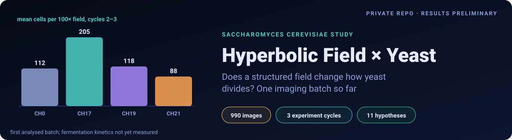
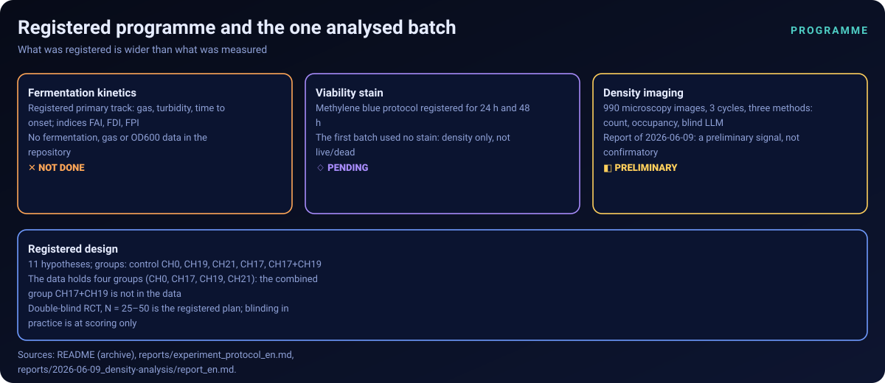
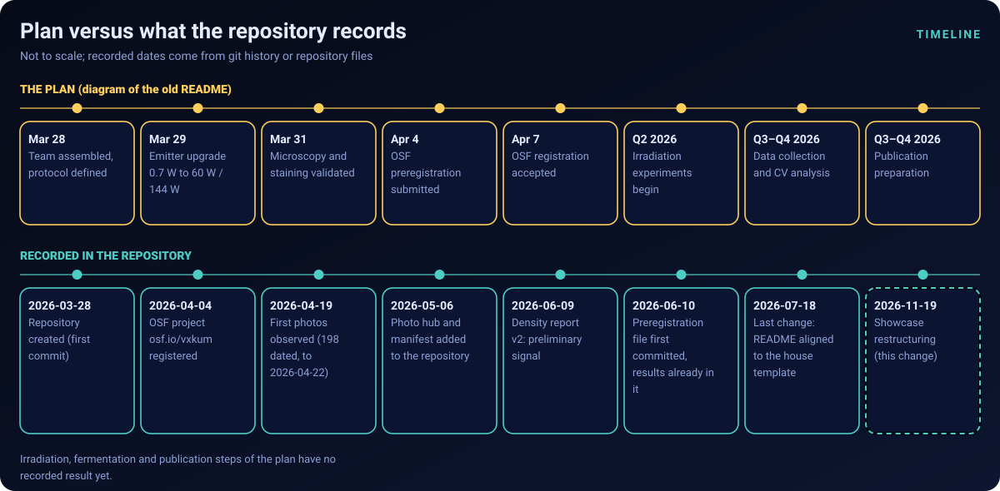
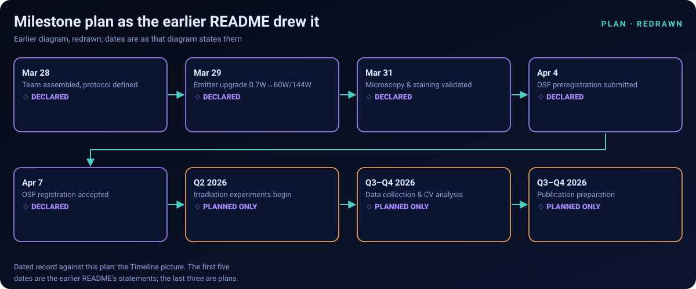
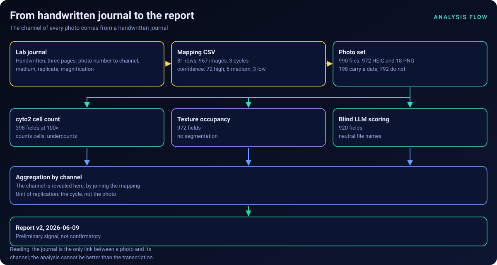
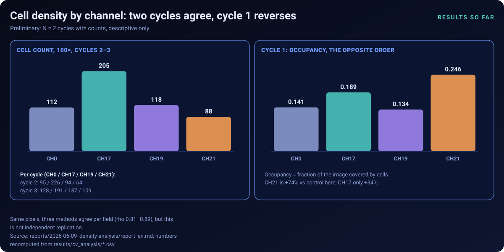
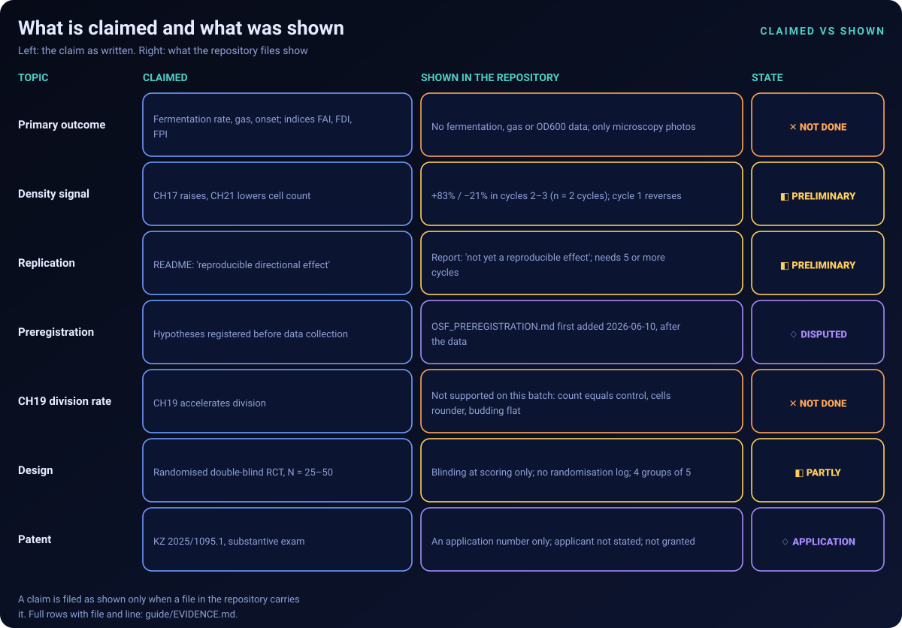
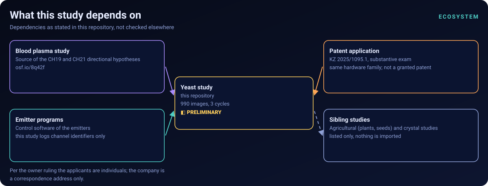
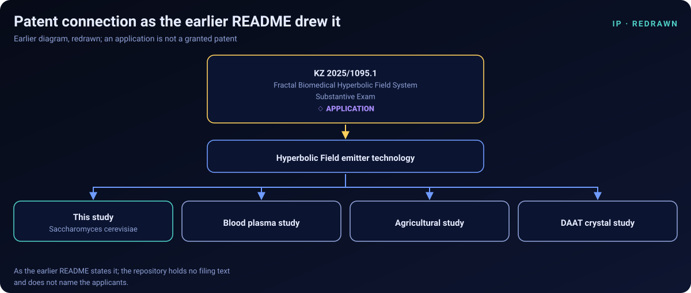

**English | [Русский](README.ru.md)**

# HYPERBOLIC FIELD SACCHAROMYCES CEREVISIAE STUDY

**Chrono-Regulatory Effects of Hyperbolic Field Modulation on Saccharomyces cerevisiae Fermentation Dynamics**

| Repository | Status |
|---|---|
| `Hyperbolic_Field_SaccharomycesCerevisiae_Study` | PRELIMINARY RESULTS |

**Part of the Advanced Scientific Research Projects (ASRP) Ecosystem**

<!-- badges -->

-f59e0b?style=flat-square)
<!-- /badges -->

> **If this work is valuable to you — support us.** 7 patron tiers from Principal Philanthropist to Individual Contributor.
>
> **Support:** <https://asrp.tech/en/patrons> 
> **Investment inquiries:** _pending — provide URL when available_

> This is a public research repository. All findings are preliminary and subject to validation. A patent application is an IP claim, not validation of the field effect.

<!-- legacy-anchors -->
## At a glance

- **The question.** Does controlled exposure to a structured physical field (the ASRP "hyperbolic field" emitter, channels CH17, CH19, CH21 against a control, CH0) change how *Saccharomyces cerevisiae* divides and ferments?
- **What was registered.** A programme on fermentation kinetics: <!--n:hypotheses-->11<!--/n--> hypotheses, five groups, a double-blind design ([Hypotheses and design](guide/DESIGN.md)).
- **What was measured.** One batch of static microscopy photographs, <!--n:images_total-->990<!--/n--> files in <!--n:cycles-->3<!--/n--> experiment cycles. It gives **cell density**, not fermentation and not viability ([Data and methods](guide/DATA.md)).
- **What it showed.** In the two cycles with counts, CH17 has <!--n:pct_ch17-->+83<!--/n-->% more cells per 100× field than control (mean <!--n:mean_ch17-->205<!--/n--> against <!--n:mean_ch0-->112<!--/n-->) and CH21 <!--n:pct_ch21-->−21<!--/n-->% fewer; a blind AI scorer agrees on the order. Cycle 1 reverses it. The study itself calls this *not yet a reproducible effect* ([Results so far](guide/RESULTS.md)).
- **What is not shown.** Fermentation kinetics, viability, the CH19 division-rate hypothesis, the combined group CH17+CH19 ([Evidence](guide/EVIDENCE.md)).
- **IP.** The linked filing KZ 2025/1095.1 is a patent application, not a granted patent ([Ecosystem](guide/ECOSYSTEM.md)).

| Images | Cycles | Hypotheses | Mapping rows | Cell-count fields | LLM-scored fields |
|:---:|:---:|:---:|:---:|:---:|:---:|
| <!--n:images_total-->990<!--/n--> | <!--n:cycles-->3<!--/n--> | <!--n:hypotheses-->11<!--/n--> | <!--n:mapping_rows-->81<!--/n--> | <!--n:count_fields-->398<!--/n--> | <!--n:llm_fields-->920<!--/n--> |

---

<!-- legacy-anchors -->
## Quick navigation

| | Page | What you get |
|---|---|---|
|  | **[The study](guide/STUDY.md)** | what it asks, registered versus analysed, timeline, team |
|  | **[Hypotheses and design](guide/DESIGN.md)** | <!--n:hypotheses-->11<!--/n--> hypotheses, design, outcomes, statistics, equipment |
|  | **[Data and methods](guide/DATA.md)** | the image set, the journal mapping, the analysis stack, AI/ML roles |
|  | **[Results so far](guide/RESULTS.md)** | cell density by channel, cycle 1 reversal, limits |
|  | **[Evidence](guide/EVIDENCE.md)** | claimed versus shown, each row with a source |
|  | **[Ecosystem, registration, patent](guide/ECOSYSTEM.md)** | companion studies, OSF record, patent application and portfolio |
|  | **[Navigation and structure](guide/NAVIGATION.md)** | where things are, folder tree |
|  | **[Open questions](guide/OPEN.md)** | inconsistencies and what needs outside access |
|  | **[Ethics, IP and security](guide/ETHICS.md)** | classification, IP status, contact, licence |
|  | **[Glossary](guide/GLOSSARY.md)** | statistics, imaging, AI and biology terms |
|  | **[Figures](guide/FIGURES.md)** | every diagram, chart and photograph in the repository |

Full list: [guide index](guide/README.md).

**On this page:** [What this study is](#what-this-study-is) · [Timeline](#timeline) · [Hypotheses and design](#hypotheses-and-design) · [Data and methods](#data-and-methods) · [Results so far](#results-so-far) · [Claimed versus shown](#claimed-versus-shown) · [Ecosystem](#asrp-ecosystem) · [OSF](#osf-preregistration) · [Patent](#patent-connection) · [Team](#research-team) · [Navigation](#navigation-and-structure) · [Open questions](#open-questions) · [Ethics](#ethics-ip-and-security) · [Contact](#contact) · [Glossary](#glossary) · [License](#license) · [Status](#status-and-roadmap)

---

<!-- legacy-anchors -->
## What this study is

<!-- excerpt STUDY 0 -->
This research project investigates the effects of hyperbolic field modulation on biological process dynamics using *Saccharomyces cerevisiae* as a model system. The study is part of a broader research program focused on chrono-regulatory and biochronal mechanisms in living systems.

The central objective is to determine whether controlled exposure to a structured physical field can induce measurable changes in fermentation kinetics, metabolic activity, and temporal organization of biochemical processes. Yeast fermentation provides a well-characterized and quantifiable system for assessing rate-based biological responses under controlled experimental conditions.

The study employs a controlled experimental design comparing exposed and non-exposed samples, with continuous and time-resolved measurements of fermentation dynamics. Primary outcome measures include fermentation rate, gas production, and temporal progression of metabolic activity.

This work aims to establish a reproducible experimental framework for investigating field-mediated modulation of biological systems, with potential implications for broader applications in biophysics, systems biology, and non-pharmacological regulation of biological processes.

All experimental materials, protocols, and data will be made available via the associated OSF project and integrated GitHub repository to ensure transparency and reproducibility.

**Where it stands.** Yeast cells were imaged under four conditions (a control and three emitter channels) in <!--n:cycles-->3<!--/n--> repeated experiments. In the two repeats that have cell counts, channel 17 shows more cells per field than control (<!--n:pct_ch17-->+83<!--/n-->%) and channel 21 fewer (<!--n:pct_ch21-->−21<!--/n-->%), and a blind AI scorer agrees on the ordering; the third repeat points the other way. The study calls this a preliminary directional signal, not a confirmed effect. Fermentation kinetics, viability and the channel 19 division-rate hypothesis have not been tested. A patent application is an IP claim, not validation of the field effect.

<!-- /excerpt -->

Full page: [The study](guide/STUDY.md)

---

<!-- legacy-anchors -->
## Timeline

<!-- excerpt STUDY 2 -->

The upper lane is the plan as the earlier README drew it (`charts/mermaid/root_3.png`, still in the repository). The lower lane is what git history and the files record; each date was checked against its source when the picture was built. The plan places irradiation experiments in the second quarter of 2026 and data collection in the second half; the repository holds photographs dated <!--n:date_first-->2026-04-19<!--/n--> to <!--n:date_last-->2026-04-22<!--/n--> (<!--n:images_dated-->198<!--/n--> of <!--n:images_total-->990<!--/n--> carry a date) and no later experimental record.

 
Original figure: <a href="charts/mermaid/root_3.png"><code>charts/mermaid/root_3.png</code></a>

<!-- /excerpt -->

Full page: [The study](guide/STUDY.md#timeline)

---

<!-- legacy-anchors -->
## Hypotheses and design

<!-- excerpt DESIGN 0 -->
| Parameter | Value |
|---|---|
| **Model organism** | *Saccharomyces cerevisiae* (Dr. Oetker dry yeast, 7g, batch L329 M68) |
| **Study type** | Randomized Controlled Experiment, double-blind (as registered) |
| **Irradiation duration** | 80 minutes (1h 20m) per session |
| **Channels** | CH17, CH19, CH21, CH17+CH19 |
| **Samples per condition** | 5-10 independent samples |
| **Total sample size** | N = 25-50 |
| **Blinding** | Double-blind: coded identifiers, researchers unaware of conditions during analysis |
| **Randomization** | Simple random assignment via RNG |
| **Emitter power** | 60W avg / 144W peak (6 nodes, clean sine wave) |
| **Temperature** | 10 C (basement) / 18 C (lab) |
| **Viability assay** | Methylene blue staining (0.1% MB + 0.01% sodium citrate); see the note on the stain strength below |
| **Logging interval** | 1 measurement per minute (~80 per session) |
| **OSF registration** | [osf.io/vxkum](https://osf.io/vxkum) (Apr 4, 2026) |
| **Patent** | Application KZ 2025/1095.1, Fractal Biomedical Hyperbolic Field System (an application, not a granted patent) |
<!-- /excerpt -->

Full page: [Hypotheses and design](guide/DESIGN.md)

---

<!-- legacy-anchors -->
## Data and methods

<!-- excerpt DATA 0 -->
The repository holds one observational image set. Counts below are computed from `data/photos/manifest.json`, `data/photos/journal-mapping.csv` and the result tables by `tools/facts.py`.

| What | Number |
|---|---|
| Image files in the manifest | <!--n:images_total-->990<!--/n--> (<!--n:images_heic-->972<!--/n--> HEIC eyepiece fields + <!--n:images_png-->18<!--/n--> PNG digital microscopy) |
| JPEG previews | <!--n:jpg_previews-->972<!--/n--> |
| Images that carry an observation date | <!--n:images_dated-->198<!--/n--> (<!--n:date_first-->2026-04-19<!--/n--> to <!--n:date_last-->2026-04-22<!--/n-->); <!--n:images_undated-->792<!--/n--> are undated |
| Journal mapping | <!--n:mapping_rows-->81<!--/n--> rows covering <!--n:mapping_images-->967<!--/n--> images in <!--n:cycles-->3<!--/n--> cycles (set 1: <!--n:set1_rows-->17<!--/n--> rows, set 2: <!--n:set2_rows-->32<!--/n-->, set 3: <!--n:set3_rows-->32<!--/n-->) |
| Mapping confidence | <!--n:conf_high-->72<!--/n--> high, <!--n:conf_med-->6<!--/n--> medium, <!--n:conf_low-->3<!--/n--> low; <!--n:mapping_blank_rows-->2<!--/n--> blank rows (one failed sample) |
| cyto2 cell counts | <!--n:count_fields-->398<!--/n--> fields at 100× |
| Occupancy scores | <!--n:occupancy_fields-->972<!--/n--> fields |
| Blind LLM scores | <!--n:llm_fields-->920<!--/n--> fields (final single-pass run); <!--n:blind_runs-->2<!--/n--> earlier pilot runs of 24 images |
| Placeholder analysis bins | <!--n:placeholder_bins-->7<!--/n--> folders (`control-NN`, `sample-chXX`) each holding one placeholder file |

**Where the channel comes from.** A photograph does not carry its experimental condition. The channel, medium, replicate and magnification of each photo come from a handwritten lab journal of three pages, transcribed into `data/photos/journal-mapping.csv` (99.5 % coverage according to the report). Every comparison between channels therefore rests on that transcription; `data/photos/journal-note.txt` holds the note about the journal.

**Unit of replication.** The replicate is the experiment cycle (set 001, 002, 003), not the photo. Many fields from one cycle are technical sub-samples; treating them as independent is pseudoreplication (see the [glossary](guide/GLOSSARY.md)). The three methods are independent algorithms but not independent observations: the two computer-vision methods read the same pixels.
<!-- /excerpt -->

Full page: [Data and methods](guide/DATA.md)

---

<!-- legacy-anchors -->
## Results so far

<!-- excerpt RESULTS 0 -->
**What was analysed.** The first imaging batch: <!--n:llm_fields-->920<!--/n--> fields scored by a blind LLM, <!--n:count_fields-->398<!--/n--> fields counted by cyto2 and <!--n:occupancy_fields-->972<!--/n--> fields scored for occupancy, from cycles 001–003 (<!--n:images_total-->990<!--/n--> images in all). The density of yeast cells differs by channel in the two cycles that have counts: **CH17 is the densest, CH21 falls below control, CH19 matches control by count.** The study's own verdict is *a directional signal in cycles 2–3, not yet a reproducible effect*: cycle 1 reverses the order, the cell counts rest on two cycles, and the p-values are descriptive.

### Comparative results

| Parameter | Control (CH0) | CH17 | CH19 | CH21 |
|---|:---:|:---:|:---:|:---:|
| **Cell count 100×** | <!--n:mean_ch0-->112<!--/n--> | **<!--n:mean_ch17-->205<!--/n--> (<!--n:pct_ch17-->+83<!--/n-->%)** | <!--n:mean_ch19-->118<!--/n--> (<!--n:pct_ch19-->+5<!--/n-->%) | **<!--n:mean_ch21-->88<!--/n--> (<!--n:pct_ch21-->−21<!--/n-->%)** |
| **vs control (×)** | 1.0× | **≈1.6–1.8×** | ≈1.05× | ≈0.79× |
| **Occupancy rank (cycles 2–3)** | mid | **1st** | 2nd | **4th (lowest)** |
| **Cell area 100×** | baseline | −12.7% (p≈6e-11 = 0.00000000006, the chance probability) | −7.6% (p≈6e-5 = 0.00006) | −6.1% (p≈4e-3 = 0.004) |
| **Cell shape (elongation)** | baseline | n.s. (not significant) | rounder, not thinner | n.s. (not significant) |

Fields counted per channel: <!--n:n_ch0-->82<!--/n--> (control), <!--n:n_ch17-->112<!--/n--> (CH17), <!--n:n_ch19-->110<!--/n--> (CH19), <!--n:n_ch21-->94<!--/n--> (CH21). These numbers were recomputed for this page from `results/cv_analysis/white_counts.csv` joined to `data/photos/journal-mapping.csv`; they reproduce the report. That checks the arithmetic and the join, not the imaging itself.

### Key findings

| Channel | Effect | Interpretation |
|---|---|---|
| **CH17** | +83% cell count, ≈1.6–1.8× control, densest in every method (cycles 2–3, 100×) | Strongest growth enhancer in these two cycles |
| **CH21** | −21% cell count, below control, sparsest in every method | Deceleration, as predicted, but cycle 1 reverses this |
| **CH19** | ≈ control by count (EXPECTED, not a null); cells ~7.6% smaller in area (p≈6e-5) but so are all field channels, and NOT more elongated (rounder if anything); budding flat | The thinner or faster-division hypothesis is NOT supported on this endpoint batch; it needs time-lapse and per-cell morphometry |

> **Caveat:** Preliminary. Two of three cycles agree; cycle 1 reverses the ordering; the data are pseudoreplicated and the p-values descriptive; the study itself asks for ≥5 cycles.
<!-- /excerpt -->

Full page: [Results so far](guide/RESULTS.md)

---

## Claimed versus shown

<!-- excerpt EVIDENCE 0 stop=^Every\srow -->

A claim is marked **shown** only when a file in the repository carries it. The study asks whether a structured field changes yeast division; what the files support is one preliminary density signal. Everything else, including the registered fermentation programme, is a plan.
<!-- /excerpt -->

Full page: [Evidence](guide/EVIDENCE.md)

---

<!-- legacy-anchors -->
## ASRP ecosystem

<!-- excerpt ECOSYSTEM 0 -->
**Part of the Advanced Scientific Research Projects (ASRP) ecosystem.** This study depends on its companion blood plasma study for the meaning of channels 19 and 21, and on the emitter programs repository for hardware control. The other repositories are only listed.

### Related research repositories

| Repository | Direction | Link |
|---|---|---|
| **Hyperbolic Field Blood Plasma Study** | Blood plasma coagulation: **companion study sharing channels CH17/CH19/CH21**; provided the plasma-system precedents for the directional channel hypotheses in this repository. OSF: [osf.io/8q42f](https://osf.io/8q42f) · DOI: [10.17605/OSF.IO/GWA9E](https://doi.org/10.17605/OSF.IO/GWA9E) | [View](https://github.com/AdvancedScientificResearchProjects/Hyperbolic_Field_BloodPlasma_Study) |
| **Hyperbolic Field Emitter Programs** | Emitter control software | [View](https://github.com/AdvancedScientificResearchProjects/Hyperbolic_Field_Emitter_Programs) |
| **Hyperbolic Field Agricultural Study** | Plant and seed growth | [View](https://github.com/AdvancedScientificResearchProjects/Hyperbolic_Field_Agricultural_Study) |
| **Hyperbolic Field DAAT Crystal Study** | Crystal-human interaction | [View](https://github.com/AdvancedScientificResearchProjects/Hyperbolic_Field_DAAT_Crystal_Study) |
| **ASRP.art** | Art and consciousness | [View](https://github.com/AdvancedScientificResearchProjects/Axionetic_Sensing_Reactions_Platform_in_Art) |
| **UAP Reverse Engineering** | UAP analysis | [View](https://github.com/AdvancedScientificResearchProjects/UAP_Reverse_Engineering_Study) |

The plasma study is a source of *hypotheses*, not of evidence for this study: the directional predictions (CH19 accelerates, CH21 decelerates) are carried over from plasma, and CH17 is exploratory. This repository cites no published article.
<!-- /excerpt -->

Full page: [ASRP ecosystem, registration and patent](guide/ECOSYSTEM.md)

---

<!-- legacy-anchors -->
## OSF preregistration

<!-- excerpt ECOSYSTEM 1 -->
| Field | Value |
|---|---|
| **Status** | Registered (per the README); registration DOI still pending, not archived |
| **Project** | [osf.io/vxkum](https://osf.io/vxkum) |
| **Registration** | [osf.io/vxkum](https://osf.io/vxkum) |
| **Template** | OSF Preregistration |
| **Registry** | OSF Registries |
| **Date submitted** | Apr 4, 2026 |
| **Date accepted** | Apr 7, 2026 |
| **License** | CC-BY-NC-ND 4.0 International |
| **Contributors** | Eight: the six researchers named on [The study](guide/STUDY.md#research-team) and two laboratory assistants (not named here) |

The registered title ("... Cell Dynamics and Morphology") differs from the README subtitle ("... Fermentation Dynamics"). For the question of when the in-repository copy was written see [Evidence](guide/EVIDENCE.md#the-preregistration-question).
<!-- /excerpt -->

Full page: [ASRP ecosystem, registration and patent](guide/ECOSYSTEM.md#osf-preregistration)

---

<!-- legacy-anchors -->
## Patent connection

<!-- excerpt ECOSYSTEM 2 -->
This study is grounded in the Fractal Biomedical Hyperbolic Field System patent **application** (see Key metrics on [Hypotheses and design](guide/DESIGN.md#key-metrics)): the emitter hardware and channel configurations (CH17/CH19/CH21) used here are the same hardware family covered by that filing.

| Patent | Application | Status | Link |
|---|---|---|---|
| **Fractal Biomedical Hyperbolic Field System** | KZ 2025/1095.1 | Substantive Exam (as written in the earlier README; an application, not a granted patent) | [View](https://github.com/denisbanchenko/Kazpatent_Fractal_Biomedical_System_Patent) |

**Who holds it.** This repository does not name the applicants of the Kazakhstan filings. An application is not a granted patent. The earlier README does not name the applicant; this repository holds no filing text.

 
Original figure: <a href="charts/mermaid/retry_1.png"><code>charts/mermaid/retry_1.png</code></a>

<!-- /excerpt -->

Full page: [ASRP ecosystem, registration and patent](guide/ECOSYSTEM.md#patent-connection)

---

<!-- legacy-anchors -->
## Research team

<!-- excerpt STUDY 3 -->
| Name | Role | Responsibilities |
|---|---|---|
| **Valeria Ovseannicova** | Director of Biomedical Research Department; Chief Researcher & Head of Experimental Work | Author of the experimental program and methodology; research infrastructure and hardware development; full-cycle research; hyperbolic field physics |
| **Denis Banchenko** | Program Director, Author of Methodology & Technology | Coordination, OSF registration, workflow |
| **Alexandr Ovsyannikov** | Head Hardware Engineer | Electrical systems |
| **Mykhailo Kapustin** | CTO & Director of AI and IT | Data infrastructure |
| **Kyryl Zmiienko** | Chief AI Engineer | Hypothesis formulation, scientific analysis |
| **Ivan Savelyev** | Science Director & Editor-in-Chief ASRP.science | Data logging protocols, methodology review |
| Two laboratory assistants (senior and junior) | Laboratory staff | Sample preparation, probe separation, laboratory support |

The earlier README lists eight researchers; the two laboratory assistants are not named here (private persons). No participant data exists in this study: the subject is yeast.
<!-- /excerpt -->

### Keywords

<!-- excerpt STUDY 4 -->
**Subjects:** Biomedical Engineering, Medical Microbiology, Biophysics, Systems Biology, Food Microbiology, Environmental Microbiology, Microbiology, Life Sciences, Medical Sciences, Biochemistry

**Tags:** biochronal processes, biological systems, biophysical fields, chrono-regulation, experimental biophysics, fermentation kinetics, field effects on biology, hyperbolic field, hyperbolic field modulation, non-classical interactions, saccharomyces cerevisiae, yeast fermentation
<!-- /excerpt -->

Full page: [The study](guide/STUDY.md#research-team)

---

<!-- legacy-anchors -->
## Navigation and structure

<!-- excerpt NAVIGATION 0 -->
The repository is a study repository, not a code project: most of its volume is photographs. Start from the question you have.

| If you want | Go to |
|---|---|
| what the study asks and where it stands | [The study](guide/STUDY.md), then [Evidence](guide/EVIDENCE.md) |
| the registered hypotheses, design and statistics | [Hypotheses and design](guide/DESIGN.md); protocol: [`reports/experiment_protocol_en.md`](reports/experiment_protocol_en.md) |
| the one analysed batch and its limits | [Results so far](guide/RESULTS.md); full report: [`report_en.md`](reports/2026-06-09_density-analysis/report_en.md) |
| how the photos map to channels | [Data and methods](guide/DATA.md); [`journal-mapping.csv`](data/photos/journal-mapping.csv), [`journal-note.txt`](data/photos/journal-note.txt) |
| the numbers behind the report | [`results/cv_analysis/`](results/cv_analysis/white_counts.csv), [`results/llm_full/`](results/llm_full/llm_full.json) |
| the analysis code | [`scripts/cv_analysis/`](scripts/cv_analysis/occupancy.py), [`scripts/llm_analysis/`](scripts/llm_analysis/run_single.py) |
| the registration and the patent application | [Ecosystem, registration and patent](guide/ECOSYSTEM.md); [`OSF_PREREGISTRATION.md`](OSF_PREREGISTRATION.md) |
| terms such as pseudoreplication, occupancy, endpoint | [Glossary](guide/GLOSSARY.md) |
| every diagram, chart and photograph | [Figures](guide/FIGURES.md) |
| what does not add up yet | [Open questions](guide/OPEN.md) |
| the data hub of the earlier README | [`data/README.md`](data/README.md) (partly stale) |
| the earlier English-only and Russian-only READMEs | [`en/README.md`](en/README.md), [`ru/README.md`](ru/README.md) |
| the previous README, unchanged | [`archive/README_2026-11-19_pre-showcase.md`](archive/README_2026-11-19_pre-showcase.md) |
<!-- /excerpt -->

Full page: [Navigation and structure](guide/NAVIGATION.md)

---

## Open questions

<!-- excerpt OPEN 0 -->
| # | What does not agree | Where | What would settle it |
|---|---|---|---|
| 1 | The preregistration file contains an already-obtained result ("found: raises cell count ×1.6–1.8") and was first committed on 2026-06-10, after the data (2026-04-19 to 2026-04-22) and the density report; the earlier README of 2026-04-09 listed fermentation outcomes as primary, the file lists cell count, occupancy and LLM scoring | `OSF_PREREGISTRATION.md:33` | the frozen April text of the OSF page |
| 2 | The README says the effect is "reproducible"; the report says "not yet a reproducible effect" | earlier README `README.md:402` against `reports/2026-06-09_density-analysis/report_en.md` (Conclusion) | the wording needs a decision; the report is the stricter source |
| 3 | Stain strength is written as "0.1% MB + 0.01% sodium citrate" in the metrics table and as "0.1 mg/mL in 2% sodium citrate dihydrate" in the protocol | `README.md:100` against `README.md:231` and `reports/experiment_protocol_en.md` | the lab's actual recipe |
| 4 | The journal note speaks of "acceleration of the 19th frequency" (in Russian) while the README states the channel numbers are control-software identifiers, not physical frequencies | `data/photos/journal-note.txt:5` against `README.md:681` | a statement from the hardware lead |
| 5 | The combined group CH17+CH19 is in the README (H9 to H11, the design table) but not in the OSF file conditions, the journal mapping or the data; N = 25–50 matches five groups, the data has four | `README.md:187` | whether that arm was run |
| 6 | `data/README.md` says 198 photos and 180 HEIC and that it does "NOT attribute photos", which contradicts `data/photos/README.md` (<!--n:images_total-->990<!--/n--> images) and the journal mapping | `data/README.md:44` | updating the data hub |
| 7 | The pilot blind runs (24 images, three "analysts") presume a methylene-blue-type stain; the researcher later confirmed there was no stain | `results/llm_blind/blind_run_2.json:13` | marking the pilots as superseded |
| 8 | The OSF registration title ("... Cell Dynamics and Morphology") differs from the README subtitle ("... Fermentation Dynamics") | `OSF_PREREGISTRATION.md` against `README.md:1` | which title is the registered one |
| 9 | The README gives a hypothesis precedent for CH17 as "found in blue whale research"; nothing in the repository sources it | `README.md:204` | a citation |
| 10 | "Randomized double-blind" is stated; blinding is applied at scoring only, channel attribution comes from a handwritten journal, and there is no randomisation record | `README.md:187`, `scripts/llm_analysis/prompts.py` | the randomisation log, if it exists |
<!-- /excerpt -->

Full page: [Open questions](guide/OPEN.md)

---

<!-- legacy-anchors -->
## Ethics, IP and security

<!-- excerpt ETHICS 0 -->
### Data classification

| Level | Access | Marking | Description |
|---|---|---|---|
| **PUBLIC** | Open | GREEN | General information |
| **RESEARCH** | Team Only | YELLOW | Research data |
| **RESTRICTED** | Core Team | RED | Sensitive analysis |
| **INTERNAL** | Director Only | BLACK | Director-level review only |

### What the repository does not contain

The subject of the study is yeast, so there is no participant data. The photographs are microscopy and equipment images. The repository holds no credentials or personal records; the two laboratory assistants of the team are not named on these pages.

### IP status

- The linked filing KZ 2025/1095.1 is a patent **application** (stated status: substantive examination). It is not a granted patent and it does not validate the field effect.
- This repository does not name the applicants of the Kazakhstan filings; an application is not a granted patent ([Ecosystem](guide/ECOSYSTEM.md#patent-connection)).
- The study text is licensed CC-BY-NC-ND 4.0 (below).

### Points to settle (the repository is public)

The repository is public. Points a reviewer should settle first, taken from [Open questions](guide/OPEN.md): whether the preregistration file may be described as a registration, the wording of the README's results claims against the report, and the residential-style address and personal details of the earlier README (kept only in the archived copy).
<!-- /excerpt -->

Full page: [Ethics, IP and security](guide/ETHICS.md)

---

<!-- legacy-anchors -->
## Contact

<!-- excerpt ETHICS 1 -->

> **If this work is valuable to you — support us.** 7 patron tiers from Principal Philanthropist to Individual Contributor.
>
> **Support:** <https://asrp.tech/en/patrons>
> **Investment inquiries:** _pending — provide URL when available_

### Contact information

| Field | Value |
|---|---|
| **Organization** | Advanced Scientific Research Projects LLP |
| **Country** | Republic of Kazakhstan |
| **Website** | [asrp.tech](https://asrp.tech) |
| **Email** | info@asrp.tech |

The earlier README also lists a postal address; it is left out here and stays in `archive/README_2026-11-19_pre-showcase.md`.
<!-- /excerpt -->

Full page: [Ethics, IP and security](guide/ETHICS.md#support-and-contact)

---

<!-- legacy-anchors -->
## Glossary

<!-- excerpt GLOSSARY 0 -->
*A plain-language key to the terms used in the results.*

- **n.s.** — not significant: the difference is too small to prove it is real.
- **p-value** — probability the result is due to chance; p < 0.05 = less than 5% chance (e.g. 6e-5 = 0.00006).
- **ρ (rho)** — method-agreement score from 0 to 1; ρ = 0.88 = very strong agreement.
- **pseudoreplication** — photos from the same dish count as 1 replicate, not many; this is why the p-values are descriptive only.
- **N=2 cycles** — the count result rests on only 2 independent experiment runs.
- **descriptive** — p-values shown for scale and direction only, not as formal proof.
- **sign-flip** — cycle 1 showed the opposite ordering from cycles 2–3.
- **endpoint** — a single-moment photo, not a time-series film of the cells.
- **CH0/CH17/CH19/CH21** — emitter settings; CH0 = emitter off (control), CH17/19/21 = three field configurations.
- **occupancy** — fraction of the image area covered by cells (0 = empty, 1 = full).
<!-- /excerpt -->

Full page: [Glossary](guide/GLOSSARY.md)

---

<!-- legacy-anchors -->
## License

<!-- excerpt ETHICS 2 -->
CC-BY-NC-ND 4.0 International

This work is licensed under the Creative Commons Attribution-NonCommercial-NoDerivatives 4.0 International License ([text](https://creativecommons.org/licenses/by-nc-nd/4.0/)).
<!-- /excerpt -->

---

## Disclaimer

<!-- excerpt ETHICS 3 -->
All findings are preliminary and subject to validation. Nothing here is medical, agricultural or other applied advice. A patent application is an IP claim, not validation of the field effect. Results come from one imaging batch and do not establish a reproducible effect.
<!-- /excerpt -->

---

<!-- legacy-anchors -->
## Status and roadmap

**Last Updated:** June 2026 (earlier README)

**Status:** Preliminary Results — irradiation/fermentation track ongoing

<!-- excerpt STUDY 5 -->
**Last updated** (earlier README): June 2026. **Status:** Preliminary results; the irradiation and fermentation track is stated as ongoing.

### Roadmap

The density batch is the first analysed slice of a larger preregistered programme. The full protocol (<!--n:hypotheses-->11<!--/n--> OSF-registered hypotheses, RCT N=25–50, double-blind) covers the irradiation/fermentation track that is still ongoing. Pending: additional cycles (≥5), staining/viability, OD600 calibration, and the full CV pipeline scripts.
<!-- /excerpt -->

Full page: [The study](guide/STUDY.md#status)
