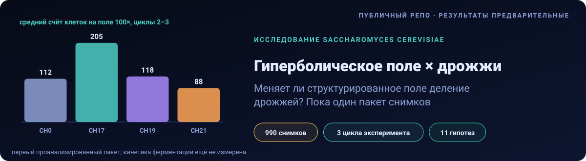
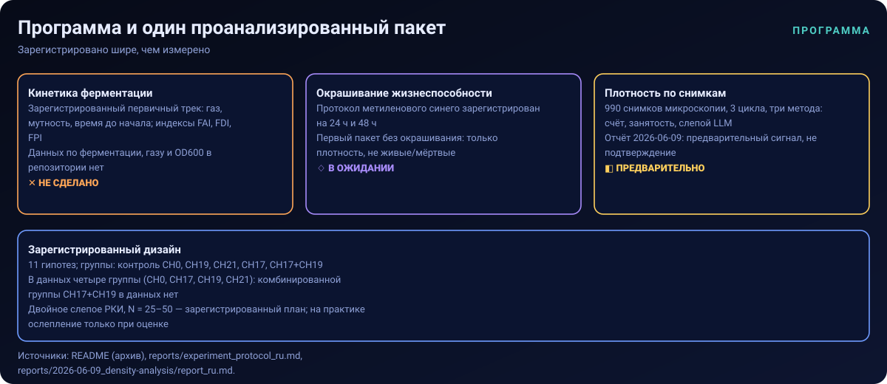
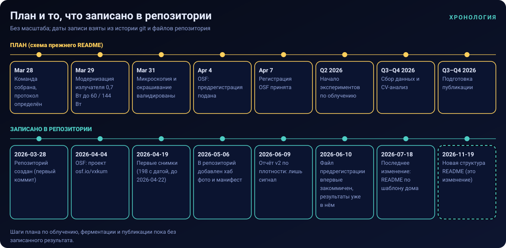
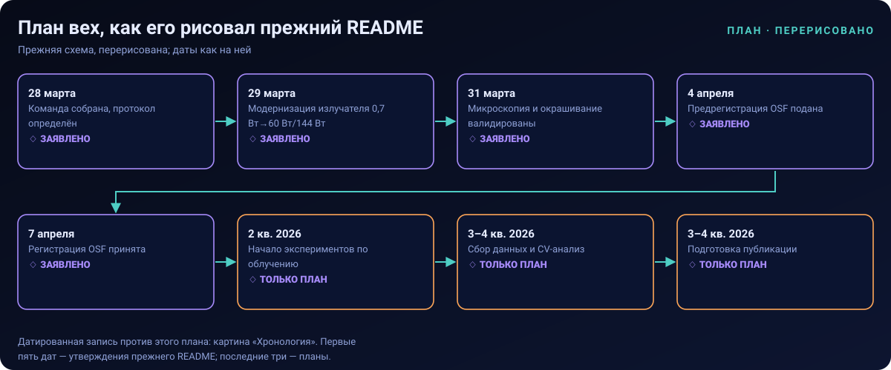
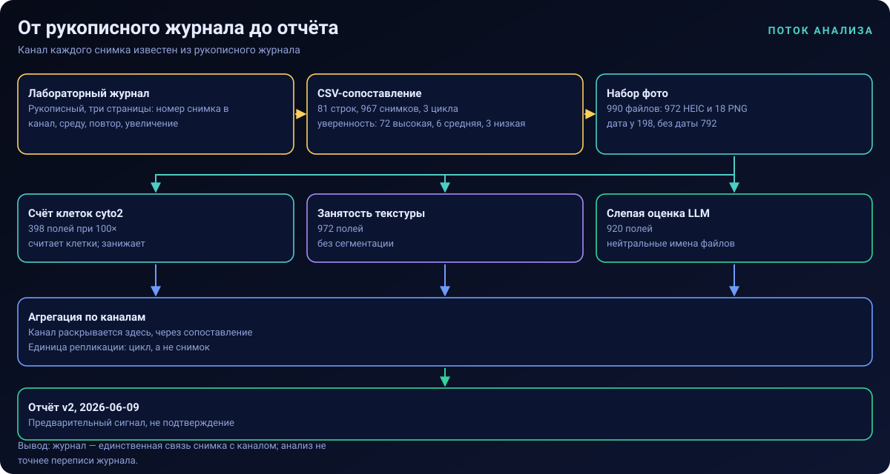
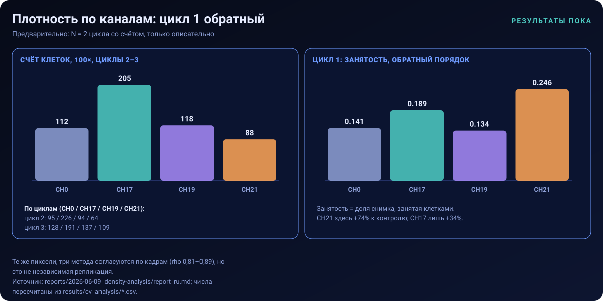
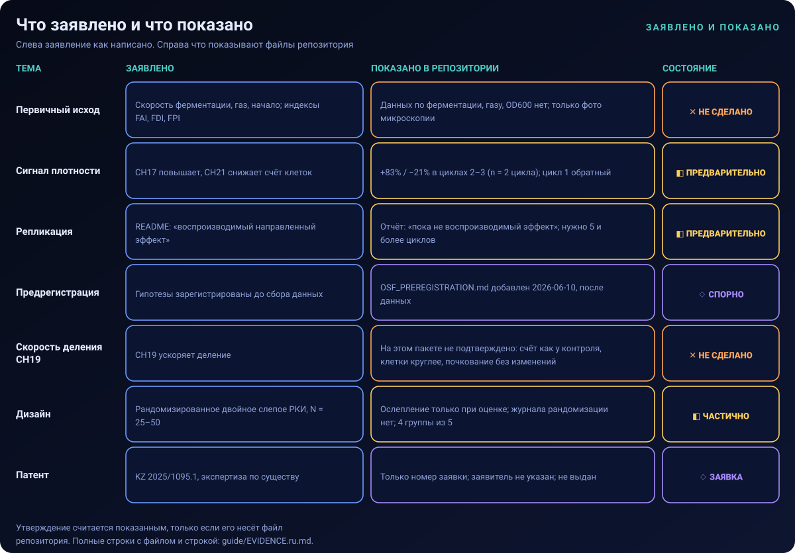
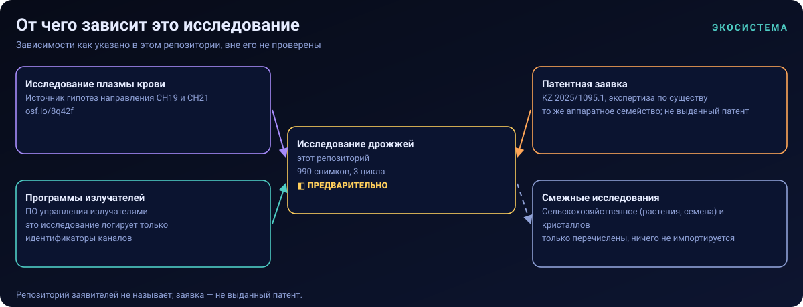
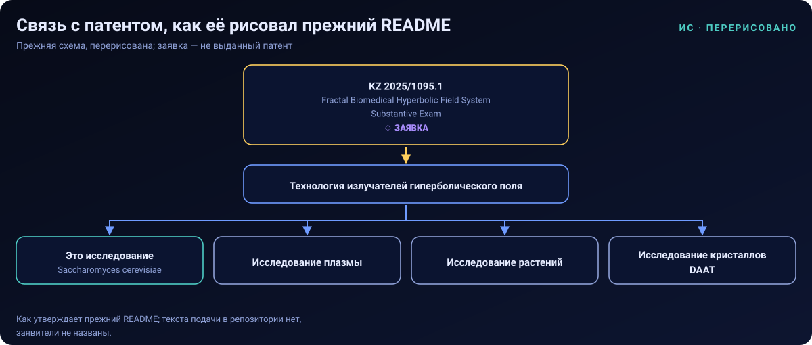

**[English](README.md) | Русский**

# ИССЛЕДОВАНИЕ ВЛИЯНИЯ ГИПЕРБОЛИЧЕСКИХ ПОЛЕЙ НА SACCHAROMYCES CEREVISIAE

**Хроно-регуляторные эффекты модуляции гиперболическим полем на динамику ферментации Saccharomyces cerevisiae**

| Репозиторий | Статус |
|---|---|
| `Hyperbolic_Field_SaccharomycesCerevisiae_Study` | ПРЕДВАРИТЕЛЬНЫЕ РЕЗУЛЬТАТЫ |

**Часть экосистемы Advanced Scientific Research Projects (ASRP)**

<!-- badges -->

-f59e0b?style=flat-square)
<!-- /badges -->

> **Если эта работа вам полезна — поддержите нас.** 7 уровней меценатства — от Главного Филантропа до Индивидуального Вкладчика.
>
> **Поддержать:** <https://asrp.tech/en/patrons> 
> **Инвестиционные запросы:** _в ожидании — добавляется при предоставлении_

> Это публичный исследовательский репозиторий. Все выводы предварительные и подлежат проверке. Патентная заявка — это заявка на защиту, а не подтверждение эффекта поля.

## Коротко

- **Вопрос.** Меняет ли контролируемое воздействие структурированного физического поля (излучатель «гиперболического поля» ASRP, каналы CH17, CH19, CH21 против контроля CH0) то, как делятся и бродят *Saccharomyces cerevisiae*?
- **Что зарегистрировано.** Программа по кинетике ферментации: <!--n:hypotheses-->11<!--/n--> гипотез, пять групп, двойное слепое ([Гипотезы и дизайн](guide/DESIGN.ru.md)).
- **Что измерено.** Один пакет статичных снимков микроскопии, <!--n:images_total-->990<!--/n--> файлов в <!--n:cycles-->3<!--/n--> циклах эксперимента. Он даёт **плотность клеток**, а не ферментацию и не жизнеспособность ([Данные и методы](guide/DATA.ru.md)).
- **Что показано.** В двух циклах со счётом у CH17 на <!--n:pct_ch17-->+83<!--/n-->% больше клеток на поле 100×, чем у контроля (среднее <!--n:mean_ch17-->205<!--/n--> против <!--n:mean_ch0-->112<!--/n-->), у CH21 на <!--n:pct_ch21-->−21<!--/n-->% меньше; слепой ИИ-оценщик согласен с порядком. Цикл 1 его обращает. Само исследование называет это *пока не воспроизводимым эффектом* ([Результаты пока](guide/RESULTS.ru.md)).
- **Чего не показано.** Кинетики ферментации, жизнеспособности, гипотезы скорости деления для CH19, комбинированной группы CH17+CH19 ([Доказательства](guide/EVIDENCE.ru.md)).
- **ИС.** Связанная подача KZ 2025/1095.1 — заявка на патент, а не выданный патент ([Экосистема](guide/ECOSYSTEM.ru.md)).

| Снимков | Циклов | Гипотез | Строк сопоставления | Полей со счётом | Полей с оценкой LLM |
|:---:|:---:|:---:|:---:|:---:|:---:|
| <!--n:images_total-->990<!--/n--> | <!--n:cycles-->3<!--/n--> | <!--n:hypotheses-->11<!--/n--> | <!--n:mapping_rows-->81<!--/n--> | <!--n:count_fields-->398<!--/n--> | <!--n:llm_fields-->920<!--/n--> |

---

## Быстрая навигация

| | Страница | Что внутри |
|---|---|---|
|  | **[Исследование](guide/STUDY.ru.md)** | что спрашивает, зарегистрировано и проанализировано, хронология, команда |
|  | **[Гипотезы и дизайн](guide/DESIGN.ru.md)** | <!--n:hypotheses-->11<!--/n--> гипотез, дизайн, исходы, статистика, оборудование |
|  | **[Данные и методы](guide/DATA.ru.md)** | набор снимков, сопоставление по журналу, аналитический стек, роли AI/ML |
|  | **[Результаты пока](guide/RESULTS.ru.md)** | плотность клеток по каналам, обратный цикл 1, границы |
|  | **[Доказательства](guide/EVIDENCE.ru.md)** | заявлено и показано, у каждой строки источник |
|  | **[Экосистема, регистрация, патент](guide/ECOSYSTEM.ru.md)** | сопутствующие исследования, запись OSF, патентная заявка и портфель |
|  | **[Навигация и структура](guide/NAVIGATION.ru.md)** | где что лежит, дерево папок |
|  | **[Открытые вопросы](guide/OPEN.ru.md)** | несоответствия и что требует доступа извне |
|  | **[Этика, ИС и безопасность](guide/ETHICS.ru.md)** | классификация, статус ИС, контакты, лицензия |
|  | **[Глоссарий](guide/GLOSSARY.ru.md)** | термины статистики, анализа изображений, AI и биологии |
|  | **[Рисунки](guide/FIGURES.ru.md)** | все схемы, графики и фотографии репозитория |

Полный список: [указатель страниц](guide/README.ru.md).

**На этой странице:** [Что это за исследование](#что-это-за-исследование) · [Хронология](#хронология) · [Гипотезы и дизайн](#гипотезы-и-дизайн) · [Данные и методы](#данные-и-методы) · [Результаты пока](#результаты-пока) · [Заявлено и показано](#заявлено-и-показано) · [Экосистема](#экосистема-asrp) · [OSF](#предварительная-регистрация-osf) · [Патент](#связь-с-патентом) · [Команда](#команда) · [Навигация](#навигация-и-структура) · [Открытые вопросы](#открытые-вопросы) · [Этика](#этика-ис-и-безопасность) · [Контакты](#контакты) · [Глоссарий](#глоссарий) · [Лицензия](#лицензия) · [Статус](#статус-и-дорожная-карта)

---

## Что это за исследование

<!-- excerpt STUDY 0 -->
Данный исследовательский проект изучает влияние модуляции гиперболическим полем на динамику биологических процессов с использованием *Saccharomyces cerevisiae* в качестве модельной системы. Исследование является частью более широкой программы, сфокусированной на хроно-регуляторных и биохронных механизмах в живых системах.

Центральная задача — определить, может ли контролируемое воздействие структурированного физического поля вызвать измеримые изменения в кинетике ферментации, метаболической активности и временной организации биохимических процессов. Дрожжевая ферментация обеспечивает хорошо охарактеризованную и количественно измеримую систему для оценки биологических ответов на основе скорости в контролируемых экспериментальных условиях.

Исследование использует контролируемый экспериментальный дизайн, сравнивающий облучённые и необлучённые образцы, с непрерывными и временно-разрешёнными измерениями динамики ферментации. Первичные исходные показатели включают скорость ферментации, газообразование и временную прогрессию метаболической активности.

Данная работа направлена на создание воспроизводимой экспериментальной основы для изучения полевой модуляции биологических систем, с потенциальными применениями в биофизике, системной биологии и нефармакологической регуляции биологических процессов.

Все экспериментальные материалы, протоколы и данные будут доступны через проект OSF и интегрированный репозиторий GitHub для обеспечения прозрачности и воспроизводимости.

**Где всё сейчас.** Клетки дрожжей снимали в четырёх условиях (контроль и три канала излучателя) в <!--n:cycles-->3<!--/n--> повторных экспериментах. В двух повторах, где есть счёт клеток, канал 17 даёт больше клеток на поле, чем контроль (<!--n:pct_ch17-->+83<!--/n-->%), а канал 21 меньше (<!--n:pct_ch21-->−21<!--/n-->%); слепой ИИ-оценщик согласен с порядком; третий повтор показывает обратное. Исследование называет это предварительным направленным сигналом, а не подтверждённым эффектом. Кинетика ферментации, жизнеспособность и гипотеза скорости деления для канала 19 не проверялись. Патентная заявка — это заявка на защиту, а не подтверждение эффекта поля.

<!-- /excerpt -->

Полная страница: [Исследование](guide/STUDY.ru.md)

---

## Хронология

<!-- excerpt STUDY 2 -->

Верхняя дорожка — план в том виде, как его рисовал прежний README (`charts/mermaid/root_3.png`, файл остаётся в репозитории). Нижняя — то, что записано в истории git и файлах; каждая дата сверена с источником при сборке картинки. План ставит эксперименты по облучению на второй квартал 2026 и сбор данных на второе полугодие; в репозитории лежат снимки с <!--n:date_first-->2026-04-19<!--/n--> по <!--n:date_last-->2026-04-22<!--/n--> (дата есть у <!--n:images_dated-->198<!--/n--> из <!--n:images_total-->990<!--/n-->) и никакой более поздней экспериментальной записи.

 
Исходная схема: <a href="charts/mermaid/root_3.png"><code>charts/mermaid/root_3.png</code></a>

<!-- /excerpt -->

Полная страница: [Исследование](guide/STUDY.ru.md#хронология)

---

## Гипотезы и дизайн

<!-- excerpt DESIGN 0 -->
| Параметр | Значение |
|---|---|
| **Модельный организм** | *Saccharomyces cerevisiae* (сухие дрожжи Dr. Oetker, 7 г, партия L329 M68) |
| **Тип исследования** | Рандомизированный контролируемый эксперимент, двойное слепое (как зарегистрировано) |
| **Длительность облучения** | 80 минут (1ч 20мин) за сессию |
| **Каналы** | CH17, CH19, CH21, CH17+CH19 |
| **Образцов на условие** | 5-10 независимых образцов |
| **Общий размер выборки** | N = 25-50 |
| **Ослепление** | Двойное слепое: кодированные идентификаторы |
| **Рандомизация** | Простая рандомизация через ГСЧ |
| **Мощность излучателя** | 60Вт средн. / 144Вт пик (6 узлов, чистая синусоида) |
| **Температура** | 10 C (подвал) / 18 C (лаборатория) |
| **Анализ жизнеспособности** | Окрашивание метиленовым синим (0.1% МС + 0.01% цитрат натрия); о концентрации красителя см. примечание ниже |
| **Интервал логирования** | 1 измерение в минуту (~80 за сессию) |
| **Регистрация OSF** | [osf.io/vxkum](https://osf.io/vxkum) (4 апреля 2026; Apr 4, 2026) |
| **Патент** | Заявка KZ 2025/1095.1, Фрактальная биомедицинская система гиперболического поля (заявка, а не выданный патент) |
<!-- /excerpt -->

Полная страница: [Гипотезы и дизайн](guide/DESIGN.ru.md)

---

## Данные и методы

<!-- excerpt DATA 0 -->
В репозитории один набор наблюдательных снимков. Числа ниже посчитаны из `data/photos/manifest.json`, `data/photos/journal-mapping.csv` и таблиц результатов скриптом `tools/facts.py`.

| Что | Число |
|---|---|
| Файлов снимков в манифесте | <!--n:images_total-->990<!--/n--> (<!--n:images_heic-->972<!--/n--> полей окуляра HEIC + <!--n:images_png-->18<!--/n--> PNG цифровой микроскопии) |
| JPEG-превью | <!--n:jpg_previews-->972<!--/n--> |
| Снимков с датой наблюдения | <!--n:images_dated-->198<!--/n--> (<!--n:date_first-->2026-04-19<!--/n--> — <!--n:date_last-->2026-04-22<!--/n-->); без даты <!--n:images_undated-->792<!--/n--> |
| Сопоставление по журналу | <!--n:mapping_rows-->81<!--/n--> строк на <!--n:mapping_images-->967<!--/n--> снимков в <!--n:cycles-->3<!--/n--> циклах (набор 1: <!--n:set1_rows-->17<!--/n--> строк, набор 2: <!--n:set2_rows-->32<!--/n-->, набор 3: <!--n:set3_rows-->32<!--/n-->) |
| Уверенность сопоставления | <!--n:conf_high-->72<!--/n--> высокая, <!--n:conf_med-->6<!--/n--> средняя, <!--n:conf_low-->3<!--/n--> низкая; <!--n:mapping_blank_rows-->2<!--/n--> пустых строки (один сорвавшийся образец) |
| Счёт клеток cyto2 | <!--n:count_fields-->398<!--/n--> полей при 100× |
| Оценки занятости | <!--n:occupancy_fields-->972<!--/n--> полей |
| Слепые оценки LLM | <!--n:llm_fields-->920<!--/n--> полей (итоговый одиночный проход); <!--n:blind_runs-->2<!--/n--> более ранних пилотных прогона по 24 снимка |
| Пустые аналитические корзины | <!--n:placeholder_bins-->7<!--/n--> папок (`control-NN`, `sample-chXX`), в каждой один файл-заглушка |

**Откуда известен канал.** Снимок не несёт своего экспериментального условия. Канал, среда, повтор и увеличение каждого снимка взяты из рукописного лабораторного журнала на три страницы, переписанного в `data/photos/journal-mapping.csv` (покрытие 99.5 % по отчёту). Поэтому любое сравнение каналов опирается на эту перепись; заметка о журнале лежит в `data/photos/journal-note.txt`.

**Единица репликации.** Репликат — цикл эксперимента (набор 001, 002, 003), а не снимок. Много полей одного цикла — технические подвыборки; считать их независимыми — псевдорепликация (см. [глоссарий](guide/GLOSSARY.ru.md)). Три метода — независимые алгоритмы, но не независимые наблюдения: два метода компьютерного зрения читают одни и те же пиксели.
<!-- /excerpt -->

Полная страница: [Данные и методы](guide/DATA.ru.md)

---

## Результаты пока

<!-- excerpt RESULTS 0 -->
**Что проанализировано.** Первый пакет снимков: <!--n:llm_fields-->920<!--/n--> полей оценены слепым LLM, <!--n:count_fields-->398<!--/n--> полей посчитаны cyto2 и <!--n:occupancy_fields-->972<!--/n--> полей оценены по занятости, циклы 001–003 (<!--n:images_total-->990<!--/n--> изображений всего). Плотность клеток дрожжей различается по каналам в двух циклах, где есть счёт: **CH17 самый плотный, CH21 ниже контроля, CH19 совпадает с контролем по счёту.** Собственный вывод исследования: *направленный сигнал в циклах 2–3, пока не воспроизводимый эффект*: цикл 1 обращает порядок, счёт клеток опирается на два цикла, p-значения описательные.

### Сравнительные результаты

| Параметр | Контроль (CH0) | CH17 | CH19 | CH21 |
|---|:---:|:---:|:---:|:---:|
| **Счёт клеток 100×** | <!--n:mean_ch0-->112<!--/n--> | **<!--n:mean_ch17-->205<!--/n--> (<!--n:pct_ch17-->+83<!--/n-->%)** | <!--n:mean_ch19-->118<!--/n--> (<!--n:pct_ch19-->+5<!--/n-->%) | **<!--n:mean_ch21-->88<!--/n--> (<!--n:pct_ch21-->−21<!--/n-->%)** |
| **к контролю (×)** | 1.0× | **≈1.6–1.8×** | ≈1.05× | ≈0.79× |
| **Ранг занятости (циклы 2–3)** | средн. | **1-й** | 2-й | **4-й (самый низкий)** |
| **Площадь клеток 100×** | база | −12.7% (p≈6e-11 = 0.00000000006, вероятность случайности) | −7.6% (p≈6e-5 = 0.00006) | −6.1% (p≈4e-3 = 0.004) |
| **Форма (вытянутость)** | база | незначимо | круглее, не тоньше | незначимо |

Полей со счётом по каналам: <!--n:n_ch0-->82<!--/n--> (контроль), <!--n:n_ch17-->112<!--/n--> (CH17), <!--n:n_ch19-->110<!--/n--> (CH19), <!--n:n_ch21-->94<!--/n--> (CH21). Эти числа пересчитаны для этой страницы из `results/cv_analysis/white_counts.csv` и `data/photos/journal-mapping.csv`; они воспроизводят отчёт. Это проверяет арифметику и сопоставление, но не сами снимки.

### Ключевые выводы

| Канал | Эффект | Интерпретация |
|---|---|---|
| **CH17** | +83% к счёту, ≈1.6–1.8× контроля, самый плотный во всех методах (циклы 2–3, 100×) | Сильнейший стимулятор роста в этих двух циклах |
| **CH21** | −21% к счёту, ниже контроля, самый разреженный во всех методах | Замедление, как и предсказано, но цикл 1 это обращает |
| **CH19** | ≈ контроль по счёту (ОЖИДАЕМО, не нулевой); клетки ~7.6% меньше по площади (p≈6e-5), но это у всех каналов поля, и НЕ более вытянутые (скорее круглее); почкование без изменений | Гипотеза «тоньше / быстрее делятся» на этой конечной точке НЕ подтверждена; нужны тайм-лапс и поклеточная морфометрия |

> **Оговорка:** предварительно. Два цикла из трёх согласуются; цикл 1 обращает порядок; данные псевдореплицированы, p-значения описательные; само исследование просит ≥5 циклов.
<!-- /excerpt -->

Полная страница: [Результаты пока](guide/RESULTS.ru.md)

---

## Заявлено и показано

<!-- excerpt EVIDENCE 0 stop=^Каждая\sстрока -->

Утверждение помечено **показано**, только если его несёт файл репозитория. Исследование спрашивает, меняет ли структурированное поле деление дрожжей; файлы поддерживают один предварительный сигнал плотности. Всё остальное, включая зарегистрированную программу ферментации, — план.
<!-- /excerpt -->

Полная страница: [Доказательства](guide/EVIDENCE.ru.md)

---

## Экосистема ASRP

<!-- excerpt ECOSYSTEM 0 -->
**Часть экосистемы Advanced Scientific Research Projects (ASRP).** Это исследование зависит от сопутствующего исследования плазмы крови в смысле каналов 19 и 21 и от репозитория программ излучателей в части управления аппаратурой. Остальные репозитории только перечислены.

### Связанные исследовательские репозитории

| Репозиторий | Направление | Ссылка |
|---|---|---|
| **Исследование плазмы крови** | Свёртываемость плазмы крови — **сопутствующее исследование, разделяющее каналы CH17/CH19/CH21**; источник прецедентов плазменных систем для направленных канальных гипотез настоящего репозитория. OSF: [osf.io/8q42f](https://osf.io/8q42f) · DOI: [10.17605/OSF.IO/GWA9E](https://doi.org/10.17605/OSF.IO/GWA9E) | [Просмотр](https://github.com/AdvancedScientificResearchProjects/Hyperbolic_Field_BloodPlasma_Study) |
| **Программы излучателей** | ПО управления излучателями | [Просмотр](https://github.com/AdvancedScientificResearchProjects/Hyperbolic_Field_Emitter_Programs) |
| **Сельскохозяйственное исследование** | Рост растений и семян | [Просмотр](https://github.com/AdvancedScientificResearchProjects/Hyperbolic_Field_Agricultural_Study) |
| **Исследование кристаллов DAAT** | Взаимодействие кристалл-человек | [Просмотр](https://github.com/AdvancedScientificResearchProjects/Hyperbolic_Field_DAAT_Crystal_Study) |
| **ASRP.art** | Искусство и сознание | [Просмотр](https://github.com/AdvancedScientificResearchProjects/Axionetic_Sensing_Reactions_Platform_in_Art) |
| **UAP Reverse Engineering** | Анализ НЛО | [Просмотр](https://github.com/AdvancedScientificResearchProjects/UAP_Reverse_Engineering_Study) |

Исследование плазмы — источник *гипотез*, а не свидетельство для этого исследования: направленные предсказания (CH19 ускоряет, CH21 замедляет) перенесены из плазмы, а CH17 поисковый. Этот репозиторий не ссылается на опубликованные статьи.
<!-- /excerpt -->

Полная страница: [Экосистема ASRP, регистрация и патент](guide/ECOSYSTEM.ru.md)

---

## Предварительная регистрация OSF

<!-- excerpt ECOSYSTEM 1 -->
| Поле | Значение |
|---|---|
| **Статус** | Зарегистрировано (по README); DOI регистрации в ожидании, не архивировано |
| **Проект** | [osf.io/vxkum](https://osf.io/vxkum) |
| **Регистрация** | [osf.io/vxkum](https://osf.io/vxkum) |
| **Шаблон** | OSF Preregistration |
| **Реестр** | OSF Registries |
| **Дата подачи** | 4 апреля 2026 (Apr 4, 2026) |
| **Дата принятия** | 7 апреля 2026 (Apr 7, 2026) |
| **Лицензия** | CC-BY-NC-ND 4.0 International |
| **Контрибьюторы** | Восемь: шесть исследователей со страницы [Исследование](guide/STUDY.ru.md#команда) и два лаборанта (здесь не называются) |

Зарегистрированное название («... Cell Dynamics and Morphology») отличается от подзаголовка README («... Fermentation Dynamics»). О времени написания копии в репозитории см. [Доказательства](guide/EVIDENCE.ru.md#вопрос-о-предрегистрации).
<!-- /excerpt -->

Полная страница: [Экосистема ASRP, регистрация и патент](guide/ECOSYSTEM.ru.md#предварительная-регистрация-osf)

---

## Связь с патентом

<!-- excerpt ECOSYSTEM 2 -->
Исследование опирается на **заявку** на Фрактальную Биомедицинскую Систему Гиперболического Поля (см. Ключевые метрики на странице [Гипотезы и дизайн](guide/DESIGN.ru.md#ключевые-метрики)): аппаратные излучатели и конфигурации каналов (CH17/CH19/CH21), используемые здесь, относятся к той же аппаратной линейке, что покрыта этой подачей.

| Патент | Заявка | Статус | Ссылка |
|---|---|---|---|
| **Фрактальная Биомедицинская Система Гиперболического Поля** | KZ 2025/1095.1 | Substantive Exam (как записано в прежнем README; заявка, а не выданный патент) | [Просмотр](https://github.com/denisbanchenko/Kazpatent_Fractal_Biomedical_System_Patent) |

**Кто правообладатель.** Этот репозиторий не называет заявителей казахстанских подач. Компания (ТОО / LLP) выступает только адресом для переписки или плательщиком пошлин; заявка — это не выданный патент. Прежний README заявителя не называет; текста подачи в этом репозитории нет.

 
Исходная схема: <a href="charts/mermaid/retry_1.png"><code>charts/mermaid/retry_1.png</code></a>

<!-- /excerpt -->

Полная страница: [Экосистема ASRP, регистрация и патент](guide/ECOSYSTEM.ru.md#связь-с-патентом)

---

## Команда

<!-- excerpt STUDY 3 -->
| ФИО | Роль | Обязанности |
|---|---|---|
| **Валерия Овсянникова** | Директор департамента биомедицинских исследований; главный исследователь и руководитель экспериментальных работ | Автор экспериментальной программы и методологии; разработчик исследовательской инфраструктуры и аппаратных установок; проведение исследований полного цикла; физика гиперболических полей |
| **Денис Банченко** | Директор программы, автор методологии и технологии | Координация, OSF, рабочий процесс |
| **Александр Овсянников** | Главный инженер по аппаратному обеспечению | Электрические системы |
| **Михайло Капустин** | Технический директор, директор ИИ и ИТ | Инфраструктура данных |
| **Кирилл Змиенко** | Главный ИИ-инженер | Формулировка гипотез, научный анализ |
| **Иван Савельев** | Директор по науке, главный редактор ASRP.science | Протоколы логирования, обзор методологии |
| Два лаборанта (старший и младший) | Лабораторный персонал | Подготовка образцов, разделение проб, лабораторная поддержка |

В прежнем README перечислены восемь исследователей; двух лаборантов здесь не называем (частные лица). Данных участников в исследовании нет: объект исследования — дрожжи.
<!-- /excerpt -->

### Ключевые слова

<!-- excerpt STUDY 4 -->
**Области:** биомедицинская инженерия, медицинская микробиология, биофизика, системная биология, пищевая микробиология, экологическая микробиология, микробиология, науки о жизни, медицинские науки, биохимия

**Теги:** биохронные процессы, биологические системы, биофизические поля, хроно-регуляция, экспериментальная биофизика, кинетика ферментации, полевые эффекты на биологию, гиперболическое поле, модуляция гиперболическим полем, неклассические взаимодействия, saccharomyces cerevisiae, ферментация дрожжей
<!-- /excerpt -->

Полная страница: [Исследование](guide/STUDY.ru.md#команда)

---

## Навигация и структура

<!-- excerpt NAVIGATION 0 -->
Это репозиторий исследования, а не программный проект: большая часть объёма — фотографии. Начните с вашего вопроса.

| Если нужно | Куда идти |
|---|---|
| что исследование спрашивает и где оно сейчас | [Исследование](guide/STUDY.ru.md), затем [Доказательства](guide/EVIDENCE.ru.md) |
| зарегистрированные гипотезы, дизайн и статистика | [Гипотезы и дизайн](guide/DESIGN.ru.md); протокол: [`reports/experiment_protocol_ru.md`](reports/experiment_protocol_ru.md) |
| единственный проанализированный пакет и его границы | [Результаты пока](guide/RESULTS.ru.md); полный отчёт: [`report_ru.md`](reports/2026-06-09_density-analysis/report_ru.md) |
| как фото соотносятся с каналами | [Данные и методы](guide/DATA.ru.md); [`journal-mapping.csv`](data/photos/journal-mapping.csv), [`journal-note.txt`](data/photos/journal-note.txt) |
| числа за отчётом | [`results/cv_analysis/`](results/cv_analysis/white_counts.csv), [`results/llm_full/`](results/llm_full/llm_full.json) |
| код анализа | [`scripts/cv_analysis/`](scripts/cv_analysis/occupancy.py), [`scripts/llm_analysis/`](scripts/llm_analysis/run_single.py) |
| регистрация и патентная заявка | [Экосистема, регистрация и патент](guide/ECOSYSTEM.ru.md); [`OSF_PREREGISTRATION.md`](OSF_PREREGISTRATION.md) |
| термины: псевдорепликация, занятость, конечная точка | [Глоссарий](guide/GLOSSARY.ru.md) |
| все схемы, графики и фотографии | [Рисунки](guide/FIGURES.ru.md) |
| что пока не сходится | [Открытые вопросы](guide/OPEN.ru.md) |
| хаб данных прежнего README | [`data/README.md`](data/README.md) (частично устарел) |
| прежние англоязычный и русскоязычный README | [`en/README.md`](en/README.md), [`ru/README.md`](ru/README.md) |
| прежний README без изменений | [`archive/README_2026-11-19_pre-showcase.md`](archive/README_2026-11-19_pre-showcase.md) |
<!-- /excerpt -->

Полная страница: [Навигация и структура](guide/NAVIGATION.ru.md)

---

## Открытые вопросы

<!-- excerpt OPEN 0 -->
| № | Что не сходится | Где | Что это разрешит |
|---|---|---|---|
| 1 | Файл предрегистрации содержит уже полученный результат («found: raises cell count ×1.6–1.8») и впервые закоммичен 2026-06-10, после данных (2026-04-19 — 2026-04-22) и отчёта по плотности; README от 2026-04-09 называл первичными исходами ферментацию, файл — счёт клеток, занятость и оценку LLM | `OSF_PREREGISTRATION.md:33` | замороженный апрельский текст страницы OSF |
| 2 | README говорит, что эффект «воспроизводим»; отчёт говорит «пока не воспроизводимый эффект» | прежний README `README.md:402` против `reports/2026-06-09_density-analysis/report_en.md` (Conclusion) | формулировку нужно решить; отчёт строже |
| 3 | Концентрация красителя записана как «0.1% MB + 0.01% sodium citrate» в таблице метрик и как «0.1 mg/mL in 2% sodium citrate dihydrate» в протоколе | `README.md:100` против `README.md:231` и `reports/experiment_protocol_en.md` | реальный рецепт лаборатории |
| 4 | В заметке журнала сказано «ускорение 19-й частоты», а README утверждает, что номера каналов — идентификаторы ПО управления, а не физические частоты | `data/photos/journal-note.txt:5` против `README.md:681` | заявление руководителя по аппаратуре |
| 5 | Комбинированная группа CH17+CH19 есть в README (H9 — H11, таблица дизайна), но не в условиях файла OSF, не в сопоставлении журнала и не в данных; N = 25–50 соответствует пяти группам, в данных четыре | `README.md:187` | проводилась ли эта группа |
| 6 | `data/README.md` говорит о 198 фото и 180 HEIC и что он «NOT attribute photos», что противоречит `data/photos/README.md` (<!--n:images_total-->990<!--/n--> снимков) и сопоставлению журнала | `data/README.md:44` | обновление хаба данных |
| 7 | Пилотные слепые прогоны (24 снимка, три «аналитика») предполагают краситель типа метиленового синего; позже руководитель подтвердил отсутствие красителя | `results/llm_blind/blind_run_2.json:13` | пометить пилоты как замещённые |
| 8 | Название регистрации OSF («... Cell Dynamics and Morphology») отличается от подзаголовка README («... Fermentation Dynamics») | `OSF_PREREGISTRATION.md` против `README.md:1` | какое название зарегистрировано |
| 9 | README приводит прецедент для CH17 как «найден в исследовании голубых китов»; в репозитории ничто его не обосновывает | `README.md:204` | ссылка на источник |
| 10 | Заявлено «рандомизированное двойное слепое»; ослепление применено только при оценке, канал берётся из рукописного журнала, записи о рандомизации нет | `README.md:187`, `scripts/llm_analysis/prompts.py` | журнал рандомизации, если он есть |
<!-- /excerpt -->

Полная страница: [Открытые вопросы](guide/OPEN.ru.md)

---

## Этика, ИС и безопасность

<!-- excerpt ETHICS 0 -->
### Классификация данных

| Уровень | Доступ | Маркировка | Описание |
|---|---|---|---|
| **ПУБЛИЧНЫЙ** | Открытый | ЗЕЛЁНЫЙ | Общая информация |
| **ИССЛЕДОВАТЕЛЬСКИЙ** | Только команда | ЖЁЛТЫЙ | Исследовательские данные |
| **ОГРАНИЧЕННЫЙ** | Основная команда | КРАСНЫЙ | Конфиденциальный анализ |
| **ВНУТРЕННИЙ** | Только директор | ЧЁРНЫЙ | Только обзор уровня директора |

### Чего в репозитории нет

Объект исследования — дрожжи, поэтому данных участников нет. Фотографии — это снимки микроскопии и оборудования. В репозитории нет учётных данных и персональных записей; двух лаборантов команды на этих страницах не называем.

### Статус ИС

- Связанная подача KZ 2025/1095.1 — **заявка** на патент (заявленный статус: экспертиза по существу). Это не выданный патент, и она не подтверждает эффект поля.
- Этот репозиторий не называет заявителей казахстанских подач; компания указана только как адрес для переписки или плательщик пошлин; заявка — не выданный патент ([Экосистема](guide/ECOSYSTEM.ru.md#связь-с-патентом)).
- Текст исследования лицензирован по CC-BY-NC-ND 4.0 (ниже).

### До открытия репозитория

Репозиторий публичный. Что рецензенту стоит решить в первую очередь, из [Открытых вопросов](guide/OPEN.ru.md): можно ли называть файл предрегистрации регистрацией, формулировки README о результатах против отчёта, а также адрес в жилом стиле и личные данные прежнего README (остаются только в архивной копии).
<!-- /excerpt -->

Полная страница: [Этика, ИС и безопасность](guide/ETHICS.ru.md)

---

## Контакты

<!-- excerpt ETHICS 1 -->

> **Если эта работа вам полезна — поддержите нас.** 7 уровней меценатства — от Главного Филантропа до Индивидуального Вкладчика.
>
> **Поддержать:** <https://asrp.tech/en/patrons>
> **Инвестиционные запросы:** _в ожидании — добавляется при предоставлении_

### Контактная информация

| Поле | Значение |
|---|---|
| **Организация** | ТОО "Перспективные Научно-Исследовательские Разработки" |
| **Страна** | Республика Казахстан |
| **Веб-сайт** | [asrp.tech](https://asrp.tech) |
| **Email** | info@asrp.tech |

Прежний README приводит ещё и почтовый адрес; здесь он опущен и остаётся в `archive/README_2026-11-19_pre-showcase.md`.
<!-- /excerpt -->

Полная страница: [Этика, ИС и безопасность](guide/ETHICS.ru.md#поддержка-и-контакты)

---

## Глоссарий

<!-- excerpt GLOSSARY 0 -->
*Краткий разбор терминов из результатов.*

- **n.s.** — незначимо: различие слишком мало, чтобы считать его реальным.
- **p-значение** — вероятность того, что результат случаен; p < 0,05 = менее 5% (например, 6e-5 = 0,00006).
- **ρ (rho)** — показатель согласия методов от 0 до 1; ρ = 0,88 = очень высокое согласие.
- **псевдорепликация** — снимки одной чашки считаются 1 репликатом, а не многими; поэтому p-значения только описательные.
- **N=2 цикла** — результат по счёту опирается лишь на 2 независимых запуска эксперимента.
- **описательно** — p-значения даны только для масштаба и направления, не как формальное доказательство.
- **смена знака** — цикл 1 показал порядок, обратный циклам 2–3.
- **конечная точка (эндпойнт)** — снимок одного момента, а не съёмка клеток во времени.
- **CH0/CH17/CH19/CH21** — настройки излучателя; CH0 = выключен (контроль), CH17/19/21 = три конфигурации поля.
- **занятость** — доля площади снимка, занятая клетками (0 = пусто, 1 = полностью).
<!-- /excerpt -->

Полная страница: [Глоссарий](guide/GLOSSARY.ru.md)

---

## Лицензия

<!-- excerpt ETHICS 2 -->
CC-BY-NC-ND 4.0 International

Данная работа лицензирована по международной лицензии Creative Commons Attribution-NonCommercial-NoDerivatives 4.0 (С указанием авторства — Некоммерческая — Без производных произведений) ([текст](https://creativecommons.org/licenses/by-nc-nd/4.0/)).
<!-- /excerpt -->

---

## Отказ от ответственности

<!-- excerpt ETHICS 3 -->
Все выводы предварительные и подлежат проверке. Ничего здесь не является медицинским, сельскохозяйственным или иным прикладным советом. Патентная заявка — это заявка на защиту, а не подтверждение эффекта поля. Результаты получены на одном пакете снимков и не устанавливают воспроизводимого эффекта.
<!-- /excerpt -->

---

## Статус и дорожная карта

**Последнее обновление:** июнь 2026 (прежний README)

**Статус:** предварительные результаты — трек облучения/ферментации продолжается

<!-- excerpt STUDY 5 -->
**Последнее обновление** (прежний README): июнь 2026. **Статус:** предварительные результаты; трек облучения и ферментации заявлен как продолжающийся.

### Дорожная карта

Пакет плотности — первый проанализированный срез более широкой предзарегистрированной программы. Полный протокол (<!--n:hypotheses-->11<!--/n--> гипотез на OSF, РКИ N=25–50, двойное слепое) охватывает трек облучения/ферментации, который ещё продолжается. В работе: дополнительные циклы (≥5), окрашивание/жизнеспособность, калибровка OD600 и полные скрипты CV-пайплайна.
<!-- /excerpt -->

Полная страница: [Исследование](guide/STUDY.ru.md#статус)
