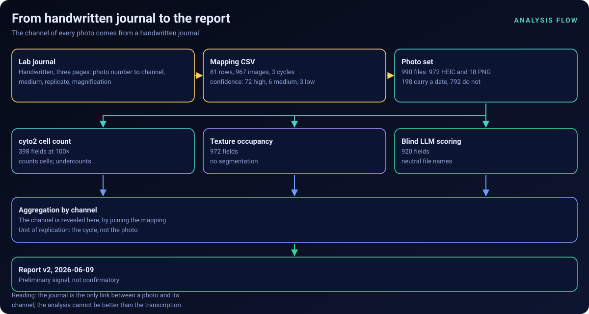
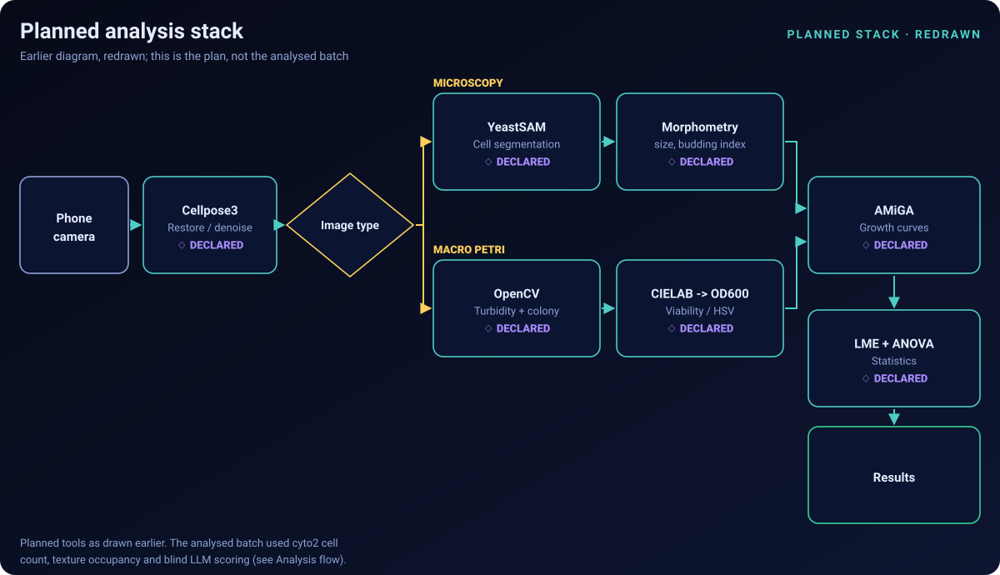

**English | [Русский](DATA.ru.md)**

[← Hyperbolic Field Saccharomyces Cerevisiae Study](../README.md) · [Guide index](README.md)

<div align="center">

# Data and methods

</div>

## The data set

The repository holds one observational image set. Counts below are computed from `data/photos/manifest.json`, `data/photos/journal-mapping.csv` and the result tables by `tools/facts.py`.

| What | Number |
|---|---|
| Image files in the manifest | <!--n:images_total-->990<!--/n--> (<!--n:images_heic-->972<!--/n--> HEIC eyepiece fields + <!--n:images_png-->18<!--/n--> PNG digital microscopy) |
| JPEG previews | <!--n:jpg_previews-->972<!--/n--> |
| Images that carry an observation date | <!--n:images_dated-->198<!--/n--> (<!--n:date_first-->2026-04-19<!--/n--> to <!--n:date_last-->2026-04-22<!--/n-->); <!--n:images_undated-->792<!--/n--> are undated |
| Journal mapping | <!--n:mapping_rows-->81<!--/n--> rows covering <!--n:mapping_images-->967<!--/n--> images in <!--n:cycles-->3<!--/n--> cycles (set 1: <!--n:set1_rows-->17<!--/n--> rows, set 2: <!--n:set2_rows-->32<!--/n-->, set 3: <!--n:set3_rows-->32<!--/n-->) |
| Mapping confidence | <!--n:conf_high-->72<!--/n--> high, <!--n:conf_med-->6<!--/n--> medium, <!--n:conf_low-->3<!--/n--> low; <!--n:mapping_blank_rows-->2<!--/n--> blank rows (one failed sample) |
| cyto2 cell counts | <!--n:count_fields-->398<!--/n--> fields at 100× |
| Occupancy scores | <!--n:occupancy_fields-->972<!--/n--> fields |
| Blind LLM scores | <!--n:llm_fields-->920<!--/n--> fields (final single-pass run); <!--n:blind_runs-->2<!--/n--> earlier pilot runs of 24 images |
| Placeholder analysis bins | <!--n:placeholder_bins-->7<!--/n--> folders (`control-NN`, `sample-chXX`) each holding one placeholder file |

**Where the channel comes from.** A photograph does not carry its experimental condition. The channel, medium, replicate and magnification of each photo come from a handwritten lab journal of three pages, transcribed into `data/photos/journal-mapping.csv` (99.5 % coverage according to the report). Every comparison between channels therefore rests on that transcription; `data/photos/journal-note.txt` holds the note about the journal.

<div align="center">
<a href="assets/diagrams/analysis-flow.en.svg"></a>
</div>

**Unit of replication.** The replicate is the experiment cycle (set 001, 002, 003), not the photo. Many fields from one cycle are technical sub-samples; treating them as independent is pseudoreplication (see the [glossary](GLOSSARY.md)). The three methods are independent algorithms but not independent observations: the two computer-vision methods read the same pixels.

## Analysis pipeline

### Stack overview (planned)

The earlier README describes this stack as the analysis pipeline. What the repository actually contains is narrower: cyto2 segmentation, a segmentation-free occupancy score and a blind LLM scoring script (next section). The tools below that are not in `scripts/` (YeastSAM, AMiGA, the CIELAB turbidity regression, napari) are **planned**, not run.

| Task | Tool | Rationale |
|---|---|---|
| **Image denoising** | Cellpose3 one-click restore | Handles phone-through-eyepiece noise, blur, vignetting |
| **Cell segmentation** | YeastSAM | 72% accuracy on budding cells vs 9-18% Cellpose3 |
| **Colony counting (macro)** | ImageJ/Fiji via PyImageJ | Validated for CFU, mature tool |
| **Turbidity (OD600 proxy)** | CIELAB regression (OpenCV) | R²=0.81 on S. cerevisiae with iPhone |
| **Viability scoring** | OpenCV LAB b* channel | Per-setup calibration required |
| **Growth curves** | AMiGA (Gaussian Process) | Non-parametric, auto phase detection, publishable |
| **Statistics** | LME (statsmodels) + Tukey | More powerful than ANOVA for repeated measures |
| **Annotation/QC** | napari + YeastSAM plugin | Native Python integration, human-in-the-loop |

### Pipeline architecture

<div align="center">
<a href="assets/diagrams/planned-pipeline.en.svg"></a><br>
<sub>Original figure: <a href="../charts/mermaid/root_2.png"><code>charts/mermaid/root_2.png</code></a></sub>
</div>

### Dependencies

```
cellpose>=3.0.0          # image restoration + yeast models
yeastsam                 # budding cell segmentation
opencv-python>=4.9.0     # preprocessing, turbidity, viability
scikit-image>=0.22.0     # morphometry
napari>=0.4.19           # interactive QC
amiga                    # growth curve fitting (GP regression)
scipy>=1.12.0            # curve fitting
statsmodels>=0.14.0      # LME models
pingouin>=0.5.4          # ANOVA + effect sizes
matplotlib>=3.8.0        # visualization
seaborn>=0.13.0          # statistical plots
pandas>=2.1.0            # data management
```

## AI/ML analysis

The density signal was triangulated across three independent analysis stacks (blind LLM vision, deep-learning segmentation, and segmentation-free classical CV). Models and roles are stated openly below.

| Provider | Model | Type | Status |
|---|---|---|---|
| **Anthropic** | Claude Opus 4.8 (claude-opus-4-8) | Blind vision density scoring | Done (920 fields, LLM-scored subset) |
| **Cellpose** | cyto2 (cellpose 3.x) | CV cell segmentation / count | Done |
| **Classical CV** | texture-occupancy + LoG blob | CV density (segmentation-free) | Done |

Blinding in practice: the scoring scripts (`scripts/llm_analysis/`) pass neutral file names and no condition to the model; the channel is joined afterwards through the journal mapping. Two earlier pilot runs in `results/llm_blind/` assume a methylene-blue-type stain that was later ruled out by the researcher; the final scoring is `results/llm_full/llm_full.json`.

## Data structure

| Folder | What it holds |
|---|---|
| `data/photos/` | Flat photo set: `manifest.json`, `journal-mapping.csv` and `.json`, `journal-note.txt`, `original/` (HEIC and PNG), `jpg/` (<!--n:jpg_previews-->972<!--/n--> previews) |
| `data/control-01` to `control-03`, `data/sample-ch17`, `sample-ch19`, `sample-ch21`, `sample-ch17-19` | Protocol-aligned analysis bins, placeholders only |
| `data/equipment/`, `data/microscopy/` | Equipment-setup and microscopy photographs |
| `results/cv_analysis/` | `white_counts.csv`, `white_counts_morpho.csv`, `occupancy_full.csv` (and `.json` twins) |
| `results/llm_blind/`, `results/llm_full/` | Pilot blind runs and the final LLM scoring |
| `reports/` | Protocol (EN, RU) and the density report with its charts |
| `scripts/` | `cv_analysis/` and `llm_analysis/` (<!--n:scripts_py-->8<!--/n--> Python files) |
| `charts/mermaid/` | <!--n:charts_mermaid-->4<!--/n--> rendered diagrams of the earlier README |
| `protocols/` | Empty placeholder |

The repository is about 2.4 GB with about 2,050 tracked files (2050), mostly raw microscopy and equipment photographs under `data/`; see [`data/README.md`](../data/README.md) for the data hub. That hub is partly stale (see [Open questions](OPEN.md)). The full annotated folder tree is on [Navigation](NAVIGATION.md#folder-tree).
