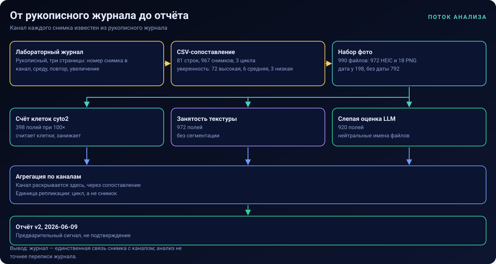

**[English](DATA.md) | Русский**

[← Исследование влияния гиперболических полей на Saccharomyces cerevisiae](../README.ru.md) · [Указатель страниц](README.ru.md)

<div align="center">

# Данные и методы

</div>

## Набор данных

В репозитории один набор наблюдательных снимков. Числа ниже посчитаны из `data/photos/manifest.json`, `data/photos/journal-mapping.csv` и таблиц результатов скриптом `tools/facts.py`.

| Что | Число |
|---|---|
| Файлов снимков в манифесте | <!--n:images_total-->990<!--/n--> (<!--n:images_heic-->972<!--/n--> полей окуляра HEIC + <!--n:images_png-->18<!--/n--> PNG цифровой микроскопии) |
| JPEG-превью | <!--n:jpg_previews-->972<!--/n--> |
| Снимков с датой наблюдения | <!--n:images_dated-->198<!--/n--> (<!--n:date_first-->2026-04-19<!--/n--> — <!--n:date_last-->2026-04-22<!--/n-->); без даты <!--n:images_undated-->792<!--/n--> |
| Сопоставление по журналу | <!--n:mapping_rows-->81<!--/n--> строк на <!--n:mapping_images-->967<!--/n--> снимков в <!--n:cycles-->3<!--/n--> циклах (набор 1: <!--n:set1_rows-->17<!--/n--> строк, набор 2: <!--n:set2_rows-->32<!--/n-->, набор 3: <!--n:set3_rows-->32<!--/n-->) |
| Уверенность сопоставления | <!--n:conf_high-->72<!--/n--> высокая, <!--n:conf_med-->6<!--/n--> средняя, <!--n:conf_low-->3<!--/n--> низкая; <!--n:mapping_blank_rows-->2<!--/n--> пустых строки (один сорвавшийся образец) |
| Счёт клеток cyto2 | <!--n:count_fields-->398<!--/n--> полей при 100× |
| Оценки занятости | <!--n:occupancy_fields-->972<!--/n--> полей |
| Слепые оценки LLM | <!--n:llm_fields-->920<!--/n--> полей (итоговый одиночный проход); <!--n:blind_runs-->2<!--/n--> более ранних пилотных прогона по 24 снимка |
| Пустые аналитические корзины | <!--n:placeholder_bins-->7<!--/n--> папок (`control-NN`, `sample-chXX`), в каждой один файл-заглушка |

**Откуда известен канал.** Снимок не несёт своего экспериментального условия. Канал, среда, повтор и увеличение каждого снимка взяты из рукописного лабораторного журнала на три страницы, переписанного в `data/photos/journal-mapping.csv` (покрытие 99.5 % по отчёту). Поэтому любое сравнение каналов опирается на эту перепись; заметка о журнале лежит в `data/photos/journal-note.txt`.

<div align="center">
<a href="assets/diagrams/analysis-flow.ru.svg"></a>
</div>

**Единица репликации.** Репликат — цикл эксперимента (набор 001, 002, 003), а не снимок. Много полей одного цикла — технические подвыборки; считать их независимыми — псевдорепликация (см. [глоссарий](GLOSSARY.ru.md)). Три метода — независимые алгоритмы, но не независимые наблюдения: два метода компьютерного зрения читают одни и те же пиксели.

## Аналитический пайплайн

### Обзор стека (план)

Прежний README описывает этот стек как аналитический пайплайн. В репозитории на деле уже: сегментация cyto2, оценка занятости без сегментации и скрипт слепой оценки LLM (следующий раздел). Инструменты ниже, которых нет в `scripts/` (YeastSAM, AMiGA, регрессия мутности CIELAB, napari), **запланированы**, не запускались.

| Задача | Инструмент | Обоснование |
|---|---|---|
| **Подавление шума** | Cellpose3 восстановление в один клик | Устраняет шум, размытие, виньетирование при съёмке через окуляр телефоном |
| **Сегментация клеток** | YeastSAM | 72% точность на почкующихся клетках vs 9-18% Cellpose3 |
| **Подсчёт колоний (макро)** | ImageJ/Fiji через PyImageJ | Валидирован для КОЕ, зрелый инструмент |
| **Мутность (OD600 прокси)** | CIELAB регрессия (OpenCV) | R²=0.81 на S. cerevisiae с iPhone |
| **Оценка жизнеспособности** | Канал b* LAB в OpenCV | Требуется калибровка для каждой установки |
| **Кривые роста** | AMiGA (Гауссовский процесс) | Непараметрический, автодетекция фаз, пригоден для публикации |
| **Статистика** | LME (statsmodels) + Тьюки | Мощнее ANOVA для повторных измерений |
| **Аннотация/КК** | napari + плагин YeastSAM | Нативная интеграция Python, человек-в-цикле |

### Архитектура пайплайна

<div align="center">
<a href="../charts/mermaid/root_2.png"></a>
</div>

### Зависимости

```
cellpose>=3.0.0          # image restoration + yeast models
yeastsam                 # budding cell segmentation
opencv-python>=4.9.0     # preprocessing, turbidity, viability
scikit-image>=0.22.0     # morphometry
napari>=0.4.19           # interactive QC
amiga                    # growth curve fitting (GP regression)
scipy>=1.12.0            # curve fitting
statsmodels>=0.14.0      # LME models
pingouin>=0.5.4          # ANOVA + effect sizes
matplotlib>=3.8.0        # visualization
seaborn>=0.13.0          # statistical plots
pandas>=2.1.0            # data management
```

## AI-анализ

Сигнал плотности подтверждён тремя независимыми аналитическими стеками (слепой LLM-визион, сегментация на основе глубокого обучения и классический CV без сегментации). Модели и их роли указаны открыто ниже.

| Провайдер | Модель | Тип | Статус |
|---|---|---|---|
| **Anthropic** | Claude Opus 4.8 (claude-opus-4-8) | Слепая визуальная оценка плотности | Готово (920 полей, подмножество, оценённое LLM) |
| **Cellpose** | cyto2 (cellpose 3.x) | CV: сегментация и подсчёт клеток | Готово |
| **Classical CV** | texture-occupancy + LoG blob | Плотность CV (без сегментации) | Готово |

Ослепление на практике: скрипты оценки (`scripts/llm_analysis/`) передают модели нейтральные имена файлов и не передают условие; канал присоединяется позже через сопоставление журнала. Два более ранних пилотных прогона в `results/llm_blind/` предполагают краситель типа метиленового синего, позже исключённый руководителем; итоговая оценка — `results/llm_full/llm_full.json`.

## Структура данных

| Папка | Что в ней |
|---|---|
| `data/photos/` | Плоский набор фото: `manifest.json`, `journal-mapping.csv` и `.json`, `journal-note.txt`, `original/` (HEIC и PNG), `jpg/` (<!--n:jpg_previews-->972<!--/n--> превью) |
| `data/control-01` — `control-03`, `data/sample-ch17`, `sample-ch19`, `sample-ch21`, `sample-ch17-19` | Аналитические корзины по протоколу, только заглушки |
| `data/equipment/`, `data/microscopy/` | Фото установки и микроскопии |
| `results/cv_analysis/` | `white_counts.csv`, `white_counts_morpho.csv`, `occupancy_full.csv` (и близнецы `.json`) |
| `results/llm_blind/`, `results/llm_full/` | Пилотные слепые прогоны и итоговая оценка LLM |
| `reports/` | Протокол (EN, RU) и отчёт по плотности с графиками |
| `scripts/` | `cv_analysis/` и `llm_analysis/` (<!--n:scripts_py-->8<!--/n--> файлов Python) |
| `charts/mermaid/` | <!--n:charts_mermaid-->4<!--/n--> отрисованные схемы прежнего README |
| `protocols/` | Пустая заглушка |

Репозиторий занимает около 2,4 ГБ (≈2.4 GB), около 2050 отслеживаемых файлов (2,050), в основном сырые фото микроскопии и оборудования в `data/`; хаб данных — [`data/README.md`](../data/README.md). Этот хаб частично устарел (см. [Открытые вопросы](OPEN.ru.md)). Полное дерево папок — на странице [Навигация](NAVIGATION.ru.md#дерево-папок).
