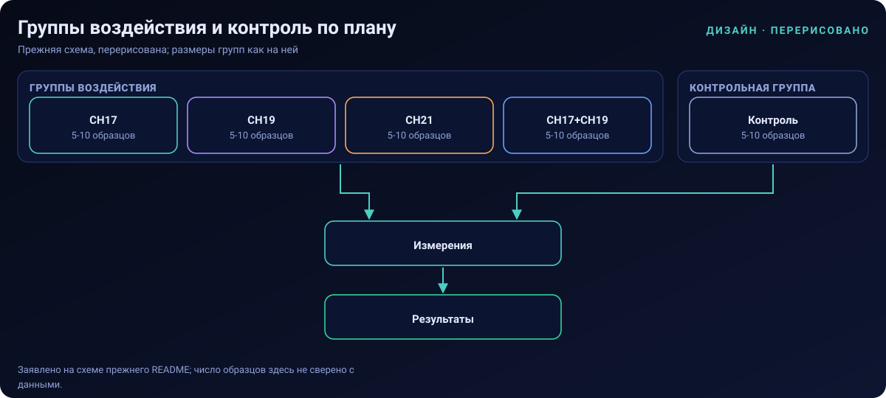

**[English](DESIGN.md) | Русский**

[← Исследование влияния гиперболических полей на Saccharomyces cerevisiae](../README.ru.md) · [Указатель страниц](README.ru.md)

<div align="center">

# Гипотезы и дизайн

</div>

Эта страница — **зарегистрированный план**: что исследование собиралось проверять и как. Это не запись того, что измерено; об этом — [Результаты пока](RESULTS.ru.md) и [Доказательства](EVIDENCE.ru.md). Копия предрегистрации в самом репозитории спорна (см. [Открытые вопросы](OPEN.ru.md)).

## Ключевые метрики

| Параметр | Значение |
|---|---|
| **Модельный организм** | *Saccharomyces cerevisiae* (сухие дрожжи Dr. Oetker, 7 г, партия L329 M68) |
| **Тип исследования** | Рандомизированный контролируемый эксперимент, двойное слепое (как зарегистрировано) |
| **Длительность облучения** | 80 минут (1ч 20мин) за сессию |
| **Каналы** | CH17, CH19, CH21, CH17+CH19 |
| **Образцов на условие** | 5-10 независимых образцов |
| **Общий размер выборки** | N = 25-50 |
| **Ослепление** | Двойное слепое: кодированные идентификаторы |
| **Рандомизация** | Простая рандомизация через ГСЧ |
| **Мощность излучателя** | 60Вт средн. / 144Вт пик (6 узлов, чистая синусоида) |
| **Температура** | 10 C (подвал) / 18 C (лаборатория) |
| **Анализ жизнеспособности** | Окрашивание метиленовым синим (0.1% МС + 0.01% цитрат натрия); о концентрации красителя см. примечание ниже |
| **Интервал логирования** | 1 измерение в минуту (~80 за сессию) |
| **Регистрация OSF** | [osf.io/vxkum](https://osf.io/vxkum) (4 апреля 2026; Apr 4, 2026) |
| **Патент** | Заявка KZ 2025/1095.1, Фрактальная биомедицинская система гиперболического поля (заявка, а не выданный патент) |

## Гипотезы

*Все гипотезы заявлены как предварительно зарегистрированные на OSF ([osf.io/vxkum](https://osf.io/vxkum)) до начала сбора данных. Собственная копия регистрации в репозитории впервые закоммичена после данных; см. [Открытые вопросы](OPEN.ru.md).*

### H1: Основная Гипотеза

Воздействие модуляции гиперболическим полем на *Saccharomyces cerevisiae* приведёт к измеримым различиям в динамике ферментации по сравнению с необлучёнными контрольными образцами.

### H2: Канал-Специфические Эффекты

Различные конфигурации гиперболического поля (CH19, CH21, CH17) вызовут отчётливые и измеримые эффекты на динамику ферментации по сравнению с контролем.

### H3: Направленная Канальная Гипотеза

На основе предыдущих наблюдений в плазменных системах (сопутствующее Исследование Плазмы Крови, osf.io/8q42f, DOI 10.17605/OSF.IO/GWA9E) гипотетически ожидается, что воздействие CH19 будет ассоциировано с повышенной активностью ферментации (т.е. ускоренным темпом деления / динамикой, НЕ увеличением биомассы или числа клеток; счёт ≈ контроль — ожидаемый результат для CH19; увеличение числа клеток относится к CH17), а CH21 — со сниженной или замедленной активностью относительно контроля.

### H4: Временная Динамика

Если эффекты гиперболического поля сохраняются после периода воздействия, различия между условиями будут увеличиваться со временем, становясь более выраженными в поздних точках наблюдения.

### H5: Транзитный Эффект

Если эффект ограничен периодом воздействия, различия будут наблюдаемы во время или сразу после, но не будут значимо увеличиваться после отключения поля.

### H6: Немедленный Морфологический Эффект

Воздействие может вызвать немедленные наблюдаемые изменения свойств образца (мутность, текстура, видимая морфология) во время или сразу после воздействия.

### H7: Неопределённость CH17

Эффект CH17 в настоящее время неизвестен. Он может (a) дать более слабый направленный эффект, аналогичный CH19, (b) вызвать качественно иные изменения, или (c) не дать измеримого эффекта.

### H8: Исследовательская Вариабельность

Воздействие может изменить вариабельность и консистентность динамики ферментации между образцами, отражая потенциальные нелинейные или системные ответы.

### H9: Взаимодействие Комбинированных Каналов

Одновременное воздействие нескольких конфигураций (CH17 + CH19) может вызвать эффекты взаимодействия, отличающиеся от эффектов отдельных каналов.

### H10: Аддитивные vs Нелинейные Эффекты

Комбинированное воздействие может привести к (a) аддитивным эффектам, (b) синергетическому усилению, или (c) антагонистическим взаимодействиям.

### H11: Направленная Комбинация

Если CH19 ассоциирован с повышенной активностью, а CH17 демонстрирует аналогичный или промежуточный эффект, комбинированное воздействие может привести к усиленной динамике ферментации по сравнению с каждым каналом в отдельности.


## Экспериментальный дизайн

### Тип дизайна

| Параметр | Значение |
|---|---|
| **Тип** | Рандомизированный, двойное слепое, контролируемый |
| **Группы** | Контроль, CH19, CH21, CH17, CH17+CH19 |
| **Образцов на группу** | 5-10 независимых образцов |
| **Всего N** | 25-50 |
| **Ослепление** | Кодированные идентификаторы образцов; исследователи не знают условий во время анализа |
| **Рандомизация** | Простое случайное распределение через ГСЧ на уровне образца |

### Группы образцов

<div align="center">
<a href="assets/diagrams/design-groups.ru.svg"></a><br>
<sub>Исходная схема: <a href="../charts/mermaid/root_1.png"><code>charts/mermaid/root_1.png</code></a></sub>
</div>

В данных четыре из этих пяти групп: комбинированной группы CH17+CH19 нет ни в сопоставлении журнала, ни на фотографиях ([Доказательства](EVIDENCE.ru.md)).

### Предсказания по каналам

| Канал | Эффект | Прецедент Плазмы |
|---|---|---|
| **CH19** | Ускорение фаз ферментации | Максимальная коагуляция + лизис |
| **CH21** | Замедление фаз ферментации | Отставал от контроля |
| **CH17** | Неизвестен -- 3 сценария | Найден в исследовании голубых китов |
| **CH17+CH19** | Эффекты взаимодействия | Не тестировался на плазме |

### Среда

| Параметр | Значение |
|---|---|
| **Место** | Подвал (-1 этаж) |
| **Освещение** | Полная темнота при облучении |
| **Температура** | 10 C (подвал); 18 C (лаборатория на 3-м этаже) |
| **Мониторинг света** | Фоторезисторы |

### График наблюдений

| Момент | Действие |
|---|---|
| До облучения | Фотография + микроскопия |
| Сразу после | Фотография + микроскопия |
| 3ч после | Фотография |
| 6h | Фотография |
| 12h | Фотография + микроскопия |
| 24h | Фотография + микроскопия + окрашивание |
| 48h | Фотография + микроскопия + окрашивание |

### Анализ жизнеспособности

**Окрашивание метиленовым синим:**
- 100 мкл клеточной суспензии + 100 мкл метиленового синего (0.1 мг/мл в 2% дигидрате цитрата натрия)
- 5 мин инкубации при комнатной температуре
- Мёртвые клетки окрашиваются синим
- Живые клетки не окрашиваются
- Почкующиеся клетки с лёгкой окраской считать живыми

> **Примечание:** Это *зарегистрированный* протокол. **Первый проанализированный пакет микроскопии (09.06.2026, 990 изображений всего — 972 поля микроскопии HEIC + 18 PNG цифровой микроскопии) окрашивание НЕ использовал** (подтверждено руководителем; синий оттенок — это среда/подсветка), поэтому он отражает только **плотность клеток**, не жизнеспособность. Окрашивание / OD600 / ферментация — в работе.

Концентрация красителя записана в прежнем README двумя способами: «0.1% МС + 0.01% цитрат натрия» в таблице метрик и «0.1 мг/мл в 2% дигидрате цитрата натрия» в протоколе (см. [Открытые вопросы](OPEN.ru.md)).

## Переменные исхода

### Первичные показатели

| Переменная | Измерение |
|---|---|
| **Активность ферментации (скорость)** | Газообразование и изменение мутности |
| **Время до начала ферментации** | Время до видимых признаков активности |
| **Динамика прогрессии ферментации** | Временная эволюция по точкам наблюдения |
| **Качественная морфология (поисковая)** | Паттерны мутности, текстура, рост |

### Производные индексы

| Индекс | Формула | Описание |
|---|---|---|
| **Индекс Активности Ферментации** | AUC_condition / AUC_control | Относительная активность |
| **Индекс Задержки Ферментации** | lag_condition - lag_control | Разница лаг-фаз |
| **Индекс Прогрессии Ферментации** | umax_condition / umax_control | Отношение максимальных скоростей |

### Контрольные переменные

Температура, состав среды, тип ёмкости, время от подготовки до воздействия.

## Статистический анализ

### Первичный анализ

Линейная модель со смешанными эффектами (LME), сравнивающая динамику ферментации по условиям:

```
log(OD) ~ Condition * Timepoint + (1 | SampleID)
```

- **Межсубъектный фактор:** условие воздействия (контроль, CH19, CH21, CH17, CH17+CH19)
- **Внутрисубъектный фактор:** время (сразу, 3ч, 6ч, 12ч, 24ч, 48ч)
- **Пост-хок:** попарные сравнения с поправкой Тьюки
- **Непараметрическая альтернатива:** Краскела-Уоллиса, если допущения ANOVA нарушены
- **Порог значимости:** p < 0.05 (двусторонний)
- **Размеры эффекта:** d Коэна, частичная эта-квадрат
- **Множественные сравнения:** Тьюки HSD для условий, Бонферрони для временных точек

Этот анализ **запланирован и не запускался**: данных оптической плотности в репозитории нет. Результаты на странице [Результаты пока](RESULTS.ru.md) описательные.

### Критерии успеха

- p < 0.05 по первичному показателю
- Умеренный размер эффекта (d >= 0.4)
- Перенос хотя бы на один вторичный показатель
- Только субъективные эффекты без количественного подтверждения = слабое доказательство

### Исключение данных

- Только контаминация, сбой подготовки или сбой записи
- Выбросы сообщаются, но не удаляются
- Пропущенные наблюдения не импутируются

## Оборудование

| Оборудование | Характеристики |
|---|---|
| **Система излучателей** | 6 узлов, 60Вт средн. / 144Вт пик, чистая синусоида |
| **Датчики температуры** | Цифровой DHT11 (темп. + влажность), размещён рядом с каждым образцом |
| **Датчики света** | Фоторезисторы + АЦП |
| **Микроскоп** | Световой микроскоп с мощной светодиодной подсветкой |
| **Центр данных** | Микропроцессор на базе Linux, 1 ТБ хранилища, автологирование |
| **Ёмкости** | Чашки Петри |
| **Реактивы** | Метиленовый синий 0.1 мг/мл, дигидрат цитрата натрия 2%, предметные стёкла |

ПО управления излучателями — отдельный репозиторий ([Экосистема ASRP](ECOSYSTEM.ru.md)); это исследование логирует только идентификаторы каналов.
