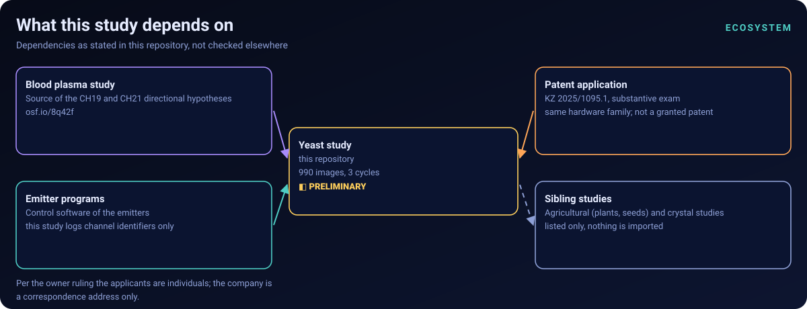
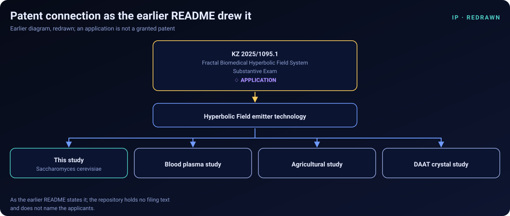

**English | [Русский](ECOSYSTEM.ru.md)**

[← Hyperbolic Field Saccharomyces Cerevisiae Study](../README.md) · [Guide index](README.md)

# ASRP ecosystem, registration and patent

## ASRP ecosystem

**Part of the Advanced Scientific Research Projects (ASRP) ecosystem.** This study depends on its companion blood plasma study for the meaning of channels 19 and 21, and on the emitter programs repository for hardware control. The other repositories are only listed.

### Related research repositories

| Repository | Direction | Link |
|---|---|---|
| **Hyperbolic Field Blood Plasma Study** | Blood plasma coagulation: **companion study sharing channels CH17/CH19/CH21**; provided the plasma-system precedents for the directional channel hypotheses in this repository. OSF: [osf.io/8q42f](https://osf.io/8q42f) · DOI: [10.17605/OSF.IO/GWA9E](https://doi.org/10.17605/OSF.IO/GWA9E) | [View](https://github.com/AdvancedScientificResearchProjects/Hyperbolic_Field_BloodPlasma_Study) |
| **Hyperbolic Field Emitter Programs** | Emitter control software | [View](https://github.com/AdvancedScientificResearchProjects/Hyperbolic_Field_Emitter_Programs) |
| **Hyperbolic Field Agricultural Study** | Plant and seed growth | [View](https://github.com/AdvancedScientificResearchProjects/Hyperbolic_Field_Agricultural_Study) |
| **Hyperbolic Field DAAT Crystal Study** | Crystal-human interaction | [View](https://github.com/AdvancedScientificResearchProjects/Hyperbolic_Field_DAAT_Crystal_Study) |
| **ASRP.art** | Art and consciousness | [View](https://github.com/AdvancedScientificResearchProjects/Axionetic_Sensing_Reactions_Platform_in_Art) |
| **UAP Reverse Engineering** | UAP analysis | [View](https://github.com/AdvancedScientificResearchProjects/UAP_Reverse_Engineering_Study) |

The plasma study is a source of *hypotheses*, not of evidence for this study: the directional predictions (CH19 accelerates, CH21 decelerates) are carried over from plasma, and CH17 is exploratory. This repository cites no published article.

## OSF preregistration

| Field | Value |
|---|---|
| **Status** | Registered (per the README); registration DOI still pending, not archived |
| **Project** | [osf.io/vxkum](https://osf.io/vxkum) |
| **Registration** | [osf.io/vxkum](https://osf.io/vxkum) |
| **Template** | OSF Preregistration |
| **Registry** | OSF Registries |
| **Date submitted** | Apr 4, 2026 |
| **Date accepted** | Apr 7, 2026 |
| **License** | CC-BY-NC-ND 4.0 International |
| **Contributors** | Eight: the six researchers named on [The study](STUDY.md#research-team) and two laboratory assistants (not named here) |

The registered title ("... Cell Dynamics and Morphology") differs from the README subtitle ("... Fermentation Dynamics"). For the question of when the in-repository copy was written see [Evidence](EVIDENCE.md#the-preregistration-question).

## Patent connection

This study is grounded in the Fractal Biomedical Hyperbolic Field System patent **application** (see Key metrics on [Hypotheses and design](DESIGN.md#key-metrics)): the emitter hardware and channel configurations (CH17/CH19/CH21) used here are the same hardware family covered by that filing.

| Patent | Application | Status | Link |
|---|---|---|---|
| **Fractal Biomedical Hyperbolic Field System** | KZ 2025/1095.1 | Substantive Exam (as written in the earlier README; an application, not a granted patent) | [View](https://github.com/denisbanchenko/Kazpatent_Fractal_Biomedical_System_Patent) |

**Who holds it.** This repository does not name the applicants of the Kazakhstan filings. The company (the TOO / LLP) appears only as a correspondence address or fee payer; an application is not a granted patent. The earlier README does not name the applicant; this repository holds no filing text.

 
Original figure: <a href="../charts/mermaid/retry_1.png"><code>charts/mermaid/retry_1.png</code></a>

## Patent portfolio

The earlier README listed the portfolio of the ASRP ecosystem for context. These are application numbers; the status of each is held in its own patent repository and was **not** checked for this page.

| Patent | Application | Link |
|---|---|---|
| **Fractal Biomedical System** | KZ 2025/1095.1 | [View](https://github.com/denisbanchenko/Kazpatent_Fractal_Biomedical_System_Patent) |
| **ASRP.art** | KZ 2025/0592.1 + PCT | [View](https://github.com/denisbanchenko/Kazpatent_Axionetic_Sensing_Reactions_Platform_in_Art_Patent) |
| **ASRP.drift** | KZ 413554 | [View](https://github.com/denisbanchenko/Kazpatent_Advanced_Synchro_Resonance_Platform_For_Deep_Resonant_Patent) |
| **GFS** | KZ 2025/1096.1 | [View](https://github.com/denisbanchenko/Kazpatent_Global_Forecasting_System_Patent) |
| **Inspira-X** | KZ 2025/0914.1 | [View](https://github.com/denisbanchenko/Kazpatent_Inspira-X_Respiratory_Analysis_Patent) |
| **Biophotonic** | KZ 2025/1097.1 | [View](https://github.com/denisbanchenko/Kazpatent_Biophotonic_Neurodiagnostic_System_Patent) |
