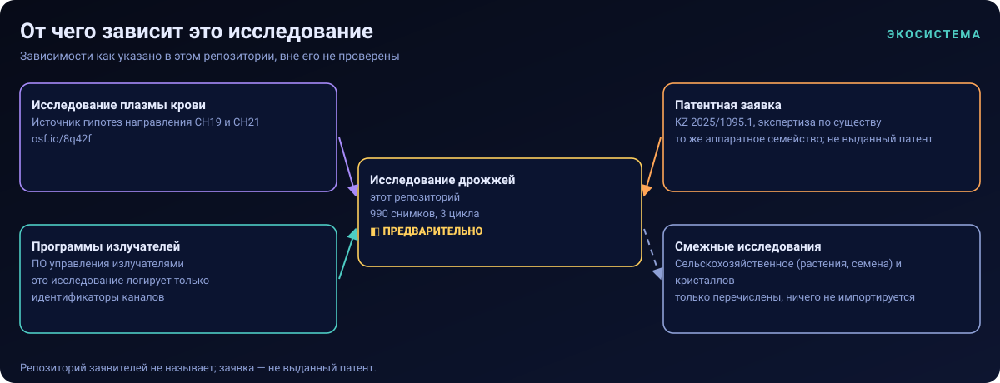

**[English](ECOSYSTEM.md) | Русский**

[← Исследование влияния гиперболических полей на Saccharomyces cerevisiae](../README.ru.md) · [Указатель страниц](README.ru.md)

# Экосистема ASRP, регистрация и патент

## Экосистема ASRP

**Часть экосистемы Advanced Scientific Research Projects (ASRP).** Это исследование зависит от сопутствующего исследования плазмы крови в смысле каналов 19 и 21 и от репозитория программ излучателей в части управления аппаратурой. Остальные репозитории только перечислены.

### Связанные исследовательские репозитории

| Репозиторий | Направление | Ссылка |
|---|---|---|
| **Исследование плазмы крови** | Свёртываемость плазмы крови — **сопутствующее исследование, разделяющее каналы CH17/CH19/CH21**; источник прецедентов плазменных систем для направленных канальных гипотез настоящего репозитория. OSF: [osf.io/8q42f](https://osf.io/8q42f) · DOI: [10.17605/OSF.IO/GWA9E](https://doi.org/10.17605/OSF.IO/GWA9E) | [Просмотр](https://github.com/AdvancedScientificResearchProjects/Hyperbolic_Field_BloodPlasma_Study) |
| **Программы излучателей** | ПО управления излучателями | [Просмотр](https://github.com/AdvancedScientificResearchProjects/Hyperbolic_Field_Emitter_Programs) |
| **Сельскохозяйственное исследование** | Рост растений и семян | [Просмотр](https://github.com/AdvancedScientificResearchProjects/Hyperbolic_Field_Agricultural_Study) |
| **Исследование кристаллов DAAT** | Взаимодействие кристалл-человек | [Просмотр](https://github.com/AdvancedScientificResearchProjects/Hyperbolic_Field_DAAT_Crystal_Study) |
| **ASRP.art** | Искусство и сознание | [Просмотр](https://github.com/AdvancedScientificResearchProjects/Axionetic_Sensing_Reactions_Platform_in_Art) |
| **UAP Reverse Engineering** | Анализ НЛО | [Просмотр](https://github.com/AdvancedScientificResearchProjects/UAP_Reverse_Engineering_Study) |

Исследование плазмы — источник *гипотез*, а не свидетельство для этого исследования: направленные предсказания (CH19 ускоряет, CH21 замедляет) перенесены из плазмы, а CH17 поисковый. Этот репозиторий не ссылается на опубликованные статьи.

## Предварительная регистрация OSF

| Поле | Значение |
|---|---|
| **Статус** | Зарегистрировано (по README); DOI регистрации в ожидании, не архивировано |
| **Проект** | [osf.io/vxkum](https://osf.io/vxkum) |
| **Регистрация** | [osf.io/vxkum](https://osf.io/vxkum) |
| **Шаблон** | OSF Preregistration |
| **Реестр** | OSF Registries |
| **Дата подачи** | 4 апреля 2026 (Apr 4, 2026) |
| **Дата принятия** | 7 апреля 2026 (Apr 7, 2026) |
| **Лицензия** | CC-BY-NC-ND 4.0 International |
| **Контрибьюторы** | Восемь: шесть исследователей со страницы [Исследование](STUDY.ru.md#команда) и два лаборанта (здесь не называются) |

Зарегистрированное название («... Cell Dynamics and Morphology») отличается от подзаголовка README («... Fermentation Dynamics»). О времени написания копии в репозитории см. [Доказательства](EVIDENCE.ru.md#вопрос-о-предрегистрации).

## Связь с патентом

Исследование опирается на **заявку** на Фрактальную Биомедицинскую Систему Гиперболического Поля (см. Ключевые метрики на странице [Гипотезы и дизайн](DESIGN.ru.md#ключевые-метрики)): аппаратные излучатели и конфигурации каналов (CH17/CH19/CH21), используемые здесь, относятся к той же аппаратной линейке, что покрыта этой подачей.

| Патент | Заявка | Статус | Ссылка |
|---|---|---|---|
| **Фрактальная Биомедицинская Система Гиперболического Поля** | KZ 2025/1095.1 | Substantive Exam (как записано в прежнем README; заявка, а не выданный патент) | [Просмотр](https://github.com/denisbanchenko/Kazpatent_Fractal_Biomedical_System_Patent) |

**Кто правообладатель.** По решению владельца заявители казахстанских подач — физические лица (этот репозиторий заявителя не называет). Компания (ТОО / LLP) выступает только адресом для переписки или плательщиком пошлин, поэтому не является заявителем или правообладателем заявки. Прежний README заявителя не называет; текста подачи в этом репозитории нет.

## Патентный портфель

Прежний README приводил портфель экосистемы ASRP для контекста. Это номера заявок; статус каждой хранится в её собственном патентном репозитории и для этой страницы **не** проверялся.

| Патент | Заявка | Ссылка |
|---|---|---|
| **Fractal Biomedical System** | KZ 2025/1095.1 | [Просмотр](https://github.com/denisbanchenko/Kazpatent_Fractal_Biomedical_System_Patent) |
| **ASRP.art** | KZ 2025/0592.1 + PCT | [Просмотр](https://github.com/denisbanchenko/Kazpatent_Axionetic_Sensing_Reactions_Platform_in_Art_Patent) |
| **ASRP.drift** | KZ 413554 | [Просмотр](https://github.com/denisbanchenko/Kazpatent_Advanced_Synchro_Resonance_Platform_For_Deep_Resonant_Patent) |
| **GFS** | KZ 2025/1096.1 | [Просмотр](https://github.com/denisbanchenko/Kazpatent_Global_Forecasting_System_Patent) |
| **Inspira-X** | KZ 2025/0914.1 | [Просмотр](https://github.com/denisbanchenko/Kazpatent_Inspira-X_Respiratory_Analysis_Patent) |
| **Biophotonic** | KZ 2025/1097.1 | [Просмотр](https://github.com/denisbanchenko/Kazpatent_Biophotonic_Neurodiagnostic_System_Patent) |
