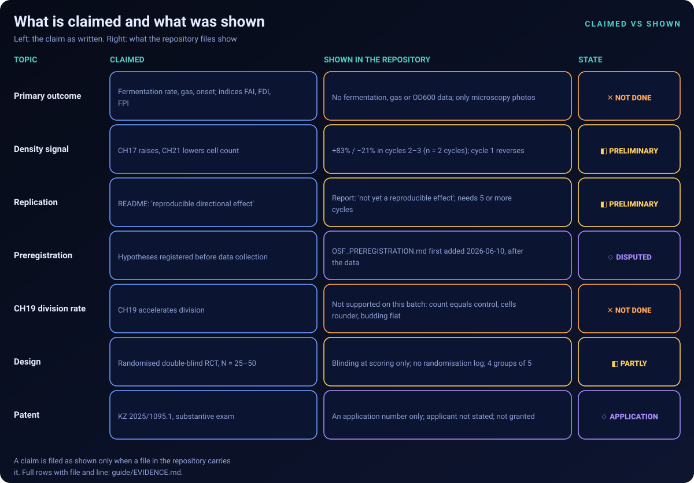

**English | [Русский](EVIDENCE.ru.md)**

[← Hyperbolic Field Saccharomyces Cerevisiae Study](../README.md) · [Guide index](README.md)

# Evidence: claimed versus shown

## Claimed versus shown

A claim is marked **shown** only when a file in the repository carries it. The study asks whether a structured field changes yeast division; what the files support is one preliminary density signal. Everything else, including the registered fermentation programme, is a plan.

Every row below names its source (`path:line`, at the repository's commit `5942aa8`).

| Topic | Claimed | Shown | State | Source |
|---|---|---|---|---|
| Primary outcome | Fermentation rate, gas production, onset; indices FAI, FDI, FPI | No fermentation, gas, OD600 or kinetic data exist in the repository | not done | `README.md:66` (archived copy `archive/README_2026-11-19_pre-showcase.md`) |
| Statistics plan | LME on optical density over timepoints | Not run: no OD data; results are descriptive only | not done | `archive/README_2026-11-19_pre-showcase.md:311` |
| Density signal | CH17 raises and CH21 lowers cell count | Cell count per 100× field, cycles 2–3: CH0 <!--n:mean_ch0-->112<!--/n-->, CH17 <!--n:mean_ch17-->205<!--/n--> (<!--n:pct_ch17-->+83<!--/n-->%), CH19 <!--n:mean_ch19-->118<!--/n-->, CH21 <!--n:mean_ch21-->88<!--/n--> (<!--n:pct_ch21-->−21<!--/n-->%); recomputed here from the CSV files and equal to the report | preliminary | `reports/2026-06-09_density-analysis/report_en.md:79` |
| Order in each cycle | Same order in the cycles | CH17 rank 1 and CH21 rank 4 in both cycles with 100× data | preliminary | `reports/2026-06-09_density-analysis/report_en.md:106` |
| Cycle 1 | (not claimed) | On occupancy cycle 1 reverses the order: CH21 <!--n:occ1_ch21-->0.246<!--/n--> against control <!--n:occ1_ch0-->0.141<!--/n-->; the report documents the flip itself | shown | `reports/2026-06-09_density-analysis/report_en.md:113` |
| Replication | README: "reproducible directional effect" | Report: "not yet a reproducible effect"; confirmation needs ≥5 cycles under one imaging protocol | preliminary | `archive/README_2026-11-19_pre-showcase.md:402`, `reports/2026-06-09_density-analysis/report_en.md:165` |
| Method agreement | Three independent methods | Strong per field (rho 0.81–0.89 at 100×), reported in the report, not recomputed here; the two CV methods read the same pixels | preliminary | `reports/2026-06-09_density-analysis/report_en.md:138` |
| CH19 division rate | CH19 accelerates division, thinner cells | Not supported on this endpoint batch: cell area −7.6% but all field channels are smaller, cells not more elongated, budding flat | not shown | `reports/2026-06-09_density-analysis/report_en.md:201` |
| Preregistration | 11 hypotheses preregistered before data collection | The in-repository `OSF_PREREGISTRATION.md` was first committed on 2026-06-10, after the data (2026-04-19 to 2026-04-22) and the 2026-06-09 report, and contains results; the OSF page text itself is not in the repository; the registration DOI is "TBD - pending" | disputed | `OSF_PREREGISTRATION.md:13`, `OSF_PREREGISTRATION.md:33` |
| Design | RCT, double-blind, simple RNG randomisation, N = 25–50, five groups | Blinding at scoring only; channel comes from a handwritten journal; no randomisation log; the CH17+CH19 group is absent from the data | partly | `archive/README_2026-11-19_pre-showcase.md:187` |
| CH17 precedent | CH17 "found in blue whale research" | Not sourced anywhere in the repository | not shown | `archive/README_2026-11-19_pre-showcase.md:204` |
| Failed sample | (not claimed) | One sample (cycle 2, control, nutrient medium, replicate 1) failed or spilled and is excluded; the mapping has two blank rows for it; it is one sample, not a failed group | shown | `reports/experiment_protocol_en.md:106` |
| Viability | Methylene blue protocol registered | The analysed batch used no stain (researcher-confirmed): density only, not live/dead | shown | `reports/experiment_protocol_en.md:81` |
| Image set | <!--n:images_total-->990<!--/n--> files | <!--n:images_heic-->972<!--/n--> HEIC + <!--n:images_png-->18<!--/n--> PNG; only <!--n:images_dated-->198<!--/n--> carry a date (<!--n:date_first-->2026-04-19<!--/n--> and <!--n:date_last-->2026-04-22<!--/n-->), <!--n:images_undated-->792<!--/n--> are undated | shown | `reports/2026-06-09_density-analysis/report_en.md:6` |
| Patent | KZ 2025/1095.1, substantive exam | An application number only; the applicant is not stated in this repository; not a granted patent | application | `archive/README_2026-11-19_pre-showcase.md:469` |
| OSF | osf.io/vxkum registered 2026-04-04, accepted 2026-04-07 | The README states it; the registration DOI is still pending and it is not archived | shown (README only) | `OSF_PREREGISTRATION.md:13` |

## Reading the table

- **Proven here** means a recomputation from the repository's own files reproduces the stated number. For the headline counts this was done (counts, per-cycle means, cycle-1 occupancy, mapping totals). It verifies the arithmetic and the join, not the imaging: there is no scale bar, the two CV methods share pixels and cyto2 undercounts by about 40% in dense fields.
- **Claimed, not proven**: the whole fermentation programme, the LME analysis, the "blue whale" precedent, the combined CH17+CH19 group, confirmation at five cycles, the OD600 doubling-time curve, the budding-index time course, viability staining and time-lapse. All are plans or proposed follow-ups.
- **Patents.** The earlier README names only an application number and the status "Substantive Exam". An application is an IP claim, not validation of the field effect and not a granted patent. This repository does not name the applicants of these filings; an application is not a granted patent (see [Ecosystem](ECOSYSTEM.md)).

## The preregistration question

The README says all hypotheses were registered on OSF before data collection (registered 2026-04-04). The file `OSF_PREREGISTRATION.md` in this repository was added on 2026-06-10, after the photographs (observed 2026-04-19 to 2026-04-22) and after the 2026-06-09 density report. It lists cell-count, occupancy and LLM scoring as primary outcomes and carries an observed result inside its "key preregistered elements" ("found: raises cell count ×1.6–1.8"), whereas the README of 2026-04-09 listed fermentation outcomes as primary. So the in-repository file is a later authored mirror, not the frozen April registration text. The April OSF page itself is not in the repository, so whether the channel hypotheses were on OSF before the data cannot be settled from here. See [Open questions](OPEN.md).

## How this page was checked

The numbers marked "recomputed" come from `tools/facts.py`, which joins `results/cv_analysis/white_counts.csv` and `occupancy_full.csv` to `data/photos/journal-mapping.csv` and recomputes them on every build. The quoted sentences were located in the named files and lines. Nothing on this page comes from outside the repository.
