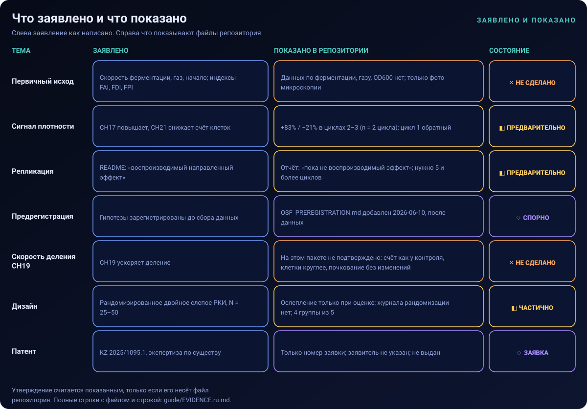

**[English](EVIDENCE.md) | Русский**

[← Исследование влияния гиперболических полей на Saccharomyces cerevisiae](../README.ru.md) · [Указатель страниц](README.ru.md)

# Доказательства: заявлено и показано

## Заявлено и показано

Утверждение помечено **показано**, только если его несёт файл репозитория. Исследование спрашивает, меняет ли структурированное поле деление дрожжей; файлы поддерживают один предварительный сигнал плотности. Всё остальное, включая зарегистрированную программу ферментации, — план.

Каждая строка ниже называет источник (`путь:строка`, коммит репозитория `5942aa8`).

| Тема | Заявлено | Показано | Состояние | Источник |
|---|---|---|---|---|
| Первичный исход | Скорость ферментации, газообразование, начало; индексы FAI, FDI, FPI | Данных по ферментации, газу, OD600 и кинетике в репозитории нет | не сделано | `README.md:66` (архивная копия `archive/README_2026-11-19_pre-showcase.md`) |
| План статистики | LME по оптической плотности по точкам времени | Не запускалась: данных OD нет; результаты только описательные | не сделано | `archive/README_2026-11-19_pre-showcase.md:311` |
| Сигнал плотности | CH17 повышает, CH21 снижает счёт клеток | Счёт клеток на поле 100×, циклы 2–3: CH0 <!--n:mean_ch0-->112<!--/n-->, CH17 <!--n:mean_ch17-->205<!--/n--> (<!--n:pct_ch17-->+83<!--/n-->%), CH19 <!--n:mean_ch19-->118<!--/n-->, CH21 <!--n:mean_ch21-->88<!--/n--> (<!--n:pct_ch21-->−21<!--/n-->%); пересчитано здесь из CSV и равно отчёту | предварительно | `reports/2026-06-09_density-analysis/report_en.md:79` |
| Порядок в каждом цикле | Тот же порядок в циклах | CH17 ранг 1 и CH21 ранг 4 в обоих циклах с данными 100× | предварительно | `reports/2026-06-09_density-analysis/report_en.md:106` |
| Цикл 1 | (не заявлено) | По занятости цикл 1 обращает порядок: CH21 <!--n:occ1_ch21-->0.246<!--/n--> против контроля <!--n:occ1_ch0-->0.141<!--/n-->; отчёт сам документирует смену знака | показано | `reports/2026-06-09_density-analysis/report_en.md:113` |
| Репликация | README: «воспроизводимый направленный эффект» | Отчёт: «пока не воспроизводимый эффект»; подтверждение требует ≥5 циклов при одном протоколе съёмки | предварительно | `archive/README_2026-11-19_pre-showcase.md:402`, `reports/2026-06-09_density-analysis/report_en.md:165` |
| Согласие методов | Три независимых метода | Сильное по кадрам (rho 0.81–0.89 при 100×), приведено в отчёте, здесь не пересчитано; два CV-метода читают одни пиксели | предварительно | `reports/2026-06-09_density-analysis/report_en.md:138` |
| Скорость деления CH19 | CH19 ускоряет деление, более тонкие клетки | Не подтверждено на этом пакете: площадь клеток −7.6%, но у всех каналов поля меньше, клетки не более вытянутые, почкование без изменений | не показано | `reports/2026-06-09_density-analysis/report_en.md:201` |
| Предрегистрация | 11 гипотез предзарегистрированы до сбора данных | Файл `OSF_PREREGISTRATION.md` в репозитории впервые закоммичен 2026-06-10, после данных (2026-04-19 — 2026-04-22) и отчёта 2026-06-09, и содержит результаты; сам текст страницы OSF в репозитории отсутствует; DOI регистрации «TBD - pending» | спорно | `OSF_PREREGISTRATION.md:13`, `OSF_PREREGISTRATION.md:33` |
| Дизайн | РКИ, двойное слепое, простая рандомизация ГСЧ, N = 25–50, пять групп | Ослепление только при оценке; канал берётся из рукописного журнала; журнала рандомизации нет; группы CH17+CH19 в данных нет | частично | `archive/README_2026-11-19_pre-showcase.md:187` |
| Прецедент CH17 | CH17 «найден в исследовании голубых китов» | Нигде в репозитории не обоснован | не показано | `archive/README_2026-11-19_pre-showcase.md:204` |
| Сорвавшийся образец | (не заявлено) | Один образец (цикл 2, контроль, питательная среда, повтор 1) сорвался или пролит и исключён; в сопоставлении для него две пустые строки; это один образец, а не сорвавшаяся группа | показано | `reports/experiment_protocol_en.md:106` |
| Жизнеспособность | Протокол метиленового синего зарегистрирован | Проанализированный пакет без красителя (подтверждено руководителем): только плотность, не живые/мёртвые | показано | `reports/experiment_protocol_en.md:81` |
| Набор снимков | <!--n:images_total-->990<!--/n--> файлов | <!--n:images_heic-->972<!--/n--> HEIC + <!--n:images_png-->18<!--/n--> PNG; дату несут только <!--n:images_dated-->198<!--/n--> (<!--n:date_first-->2026-04-19<!--/n--> и <!--n:date_last-->2026-04-22<!--/n-->), без даты <!--n:images_undated-->792<!--/n--> | показано | `reports/2026-06-09_density-analysis/report_en.md:6` |
| Патент | KZ 2025/1095.1, экспертиза по существу | Только номер заявки; заявитель в этом репозитории не указан; не выданный патент | заявка | `archive/README_2026-11-19_pre-showcase.md:469` |
| OSF | osf.io/vxkum зарегистрирован 2026-04-04, принят 2026-04-07 | Это сказано в README; DOI регистрации ещё в ожидании, архива нет | показано (только README) | `OSF_PREREGISTRATION.md:13` |

## Как читать таблицу

- **Подтверждено здесь** означает, что пересчёт по собственным файлам репозитория воспроизводит названное число. Для главных счётов это сделано (счёты, средние по циклам, занятость цикла 1, итоги сопоставления). Проверяется арифметика и сопоставление, но не сами снимки: масштабной линейки нет, два CV-метода читают одни пиксели, cyto2 недосчитывает около 40% в плотных полях.
- **Заявлено, не доказано**: вся программа ферментации, анализ LME, прецедент про голубых китов, комбинированная группа CH17+CH19, подтверждение на пяти циклах, кривая времени удвоения по OD600, динамика индекса почкования, окрашивание жизнеспособности и тайм-лапс. Всё это планы или предложенные продолжения.
- **Патенты.** Прежний README называет только номер заявки и статус «Substantive Exam». Заявка — это заявка на защиту, а не подтверждение эффекта поля и не выданный патент. Этот репозиторий не называет заявителей этих подач; заявка — не выданный патент (см. [Экосистема](ECOSYSTEM.ru.md)).

## Вопрос о предрегистрации

README говорит, что все гипотезы были зарегистрированы на OSF до сбора данных (регистрация 2026-04-04). Файл `OSF_PREREGISTRATION.md` в этом репозитории добавлен 2026-06-10, после снимков (сняты 2026-04-19 — 2026-04-22) и после отчёта по плотности от 2026-06-09. Он называет первичными исходами счёт клеток, занятость и оценку LLM и содержит наблюдённый результат внутри «ключевых элементов регистрации» («found: raises cell count ×1.6–1.8»), тогда как README от 2026-04-09 называл первичными исходами ферментацию. То есть файл в репозитории — позднее авторское зеркало, а не замороженный апрельский текст регистрации. Самой апрельской страницы OSF в репозитории нет, поэтому были ли канальные гипотезы на OSF до данных, отсюда установить нельзя. См. [Открытые вопросы](OPEN.ru.md).

## Как проверена эта страница

Числа с пометкой «пересчитано» берутся из `tools/facts.py`, который при каждой сборке соединяет `results/cv_analysis/white_counts.csv` и `occupancy_full.csv` с `data/photos/journal-mapping.csv` и пересчитывает их. Цитируемые предложения найдены в названных файлах и строках. Ничего на этой странице не взято извне репозитория.
