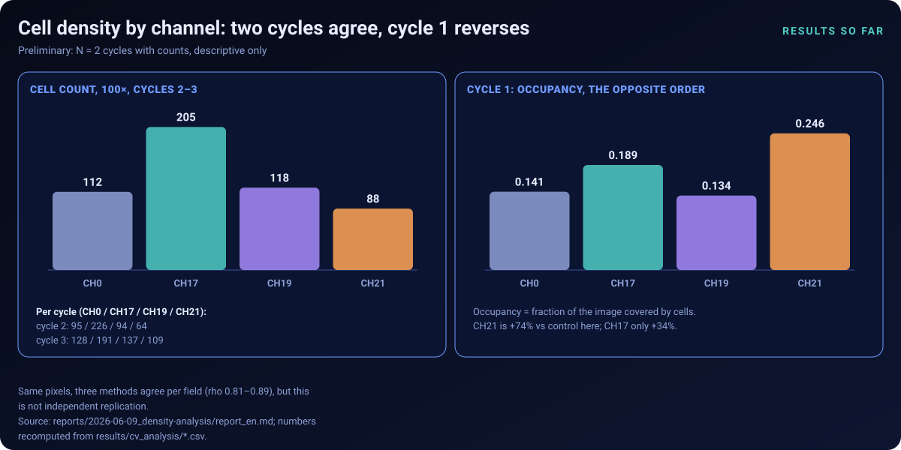

**English | [Русский](RESULTS.ru.md)**

[← Hyperbolic Field Saccharomyces Cerevisiae Study](../README.md) · [Guide index](README.md)

# Results so far

## Key results

**What was analysed.** The first imaging batch: <!--n:llm_fields-->920<!--/n--> fields scored by a blind LLM, <!--n:count_fields-->398<!--/n--> fields counted by cyto2 and <!--n:occupancy_fields-->972<!--/n--> fields scored for occupancy, from cycles 001–003 (<!--n:images_total-->990<!--/n--> images in all). The density of yeast cells differs by channel in the two cycles that have counts: **CH17 is the densest, CH21 falls below control, CH19 matches control by count.** The study's own verdict is *a directional signal in cycles 2–3, not yet a reproducible effect*: cycle 1 reverses the order, the cell counts rest on two cycles, and the p-values are descriptive.

### Comparative results

| Parameter | Control (CH0) | CH17 | CH19 | CH21 |
|---|:---:|:---:|:---:|:---:|
| **Cell count 100×** | <!--n:mean_ch0-->112<!--/n--> | **<!--n:mean_ch17-->205<!--/n--> (<!--n:pct_ch17-->+83<!--/n-->%)** | <!--n:mean_ch19-->118<!--/n--> (<!--n:pct_ch19-->+5<!--/n-->%) | **<!--n:mean_ch21-->88<!--/n--> (<!--n:pct_ch21-->−21<!--/n-->%)** |
| **vs control (×)** | 1.0× | **≈1.6–1.8×** | ≈1.05× | ≈0.79× |
| **Occupancy rank (cycles 2–3)** | mid | **1st** | 2nd | **4th (lowest)** |
| **Cell area 100×** | baseline | −12.7% (p≈6e-11 = 0.00000000006, the chance probability) | −7.6% (p≈6e-5 = 0.00006) | −6.1% (p≈4e-3 = 0.004) |
| **Cell shape (elongation)** | baseline | n.s. (not significant) | rounder, not thinner | n.s. (not significant) |

Fields counted per channel: <!--n:n_ch0-->82<!--/n--> (control), <!--n:n_ch17-->112<!--/n--> (CH17), <!--n:n_ch19-->110<!--/n--> (CH19), <!--n:n_ch21-->94<!--/n--> (CH21). These numbers were recomputed for this page from `results/cv_analysis/white_counts.csv` joined to `data/photos/journal-mapping.csv`; they reproduce the report. That checks the arithmetic and the join, not the imaging itself.

### Key findings

| Channel | Effect | Interpretation |
|---|---|---|
| **CH17** | +83% cell count, ≈1.6–1.8× control, densest in every method (cycles 2–3, 100×) | Strongest growth enhancer in these two cycles |
| **CH21** | −21% cell count, below control, sparsest in every method | Deceleration, as predicted, but cycle 1 reverses this |
| **CH19** | ≈ control by count (EXPECTED, not a null); cells ~7.6% smaller in area (p≈6e-5) but so are all field channels, and NOT more elongated (rounder if anything); budding flat | The thinner or faster-division hypothesis is NOT supported on this endpoint batch; it needs time-lapse and per-cell morphometry |

> **Caveat:** Preliminary. Two of three cycles agree; cycle 1 reverses the ordering; the data are pseudoreplicated and the p-values descriptive; the study itself asks for ≥5 cycles.

## Per cycle and per method

| Cycle | CH0 | CH17 | CH19 | CH21 |
|---|:---:|:---:|:---:|:---:|
| Cycle 2 (100× count) | <!--n:cyc2_ch0-->95<!--/n--> | **<!--n:cyc2_ch17-->226<!--/n-->** | <!--n:cyc2_ch19-->94<!--/n--> | **<!--n:cyc2_ch21-->64<!--/n-->** |
| Cycle 3 (100× count) | <!--n:cyc3_ch0-->128<!--/n--> | **<!--n:cyc3_ch17-->191<!--/n-->** | <!--n:cyc3_ch19-->137<!--/n--> | **<!--n:cyc3_ch21-->109<!--/n-->** |
| Cycle 1 (occupancy only) | <!--n:occ1_ch0-->0.141<!--/n--> | <!--n:occ1_ch17-->0.189<!--/n--> | <!--n:occ1_ch19-->0.134<!--/n--> | **<!--n:occ1_ch21-->0.246<!--/n-->** |

CH17 ranks first and CH21 last in both cycles that have counts. In cycle 1 there is no magnification split and no count; on occupancy CH21 is the densest (<!--n:occ1_pct_ch21-->+74<!--/n-->% against control) and CH17 is second (<!--n:occ1_pct_ch17-->+34<!--/n-->%), which inverts both headline claims. This is a sign flip in the data, not an outlier.

## Preliminary results

**Status:** first imaging batch analysed (990 total images, cycles 001–003).

**Key finding:** a directional effect on cell density across three independent image-analysis methods (CV cell count, CV occupancy, blind LLM): **CH17 highest (~×1.6–1.8 vs control), CH21 below control, CH19 ≈ control.** Directionally consistent with the protocol prediction that CH21 decelerates division. The earlier README called this "reproducible"; the report says "not yet a reproducible effect", and that is the wording to use.

| Channel | Cell count 100× | vs control |
|---|:---:|:---:|
| CH0 (control) | <!--n:mean_ch0-->112<!--/n--> | — |
| **CH17** | **<!--n:mean_ch17-->205<!--/n-->** | **+83 %** |
| CH19 | <!--n:mean_ch19-->118<!--/n--> | +5 % |
| **CH21** | **<!--n:mean_ch21-->88<!--/n-->** | **−21 %** |

Per-field method agreement (Spearman): CV-count ↔ occupancy ρ=0.88; occupancy ↔ LLM ρ=0.89; CV-count ↔ LLM ρ=0.81 (at 100×).

> **Preliminary, not confirmatory:** 3 cycles only, cycle 1 disagrees, no scale bar; the evidence is cross-method and cross-cycle consistency, not p-values. Needs ≥5 cycles.

## Limits of the batch

1. **Replication.** Three cycles; the signal holds in cycles 2–3 and cycle 1 contradicts it (a different imaging protocol, no magnification split).
2. **Pseudoreplication.** Fields within a cycle are not independent, so per-field p-values are descriptive only.
3. **No scale bar.** Densities are relative (cells per field, occupancy fraction), not cells per mL.
4. **Systematic undercount.** cyto2 misses about 40% of cells in dense fields; relative channel comparison stays valid, absolute counts do not.
5. **Possible imaging confounds** (focus, dilution, session) per channel are not excluded; the two CV methods read the same pixels.
6. **No viability measure.** There is no vital stain in this batch.
7. **CH19's kinetic hypothesis is untestable from static endpoints.** It needs OD600 doubling time and time-lapse.

Full report: [EN](../reports/2026-06-09_density-analysis/report_en.md) | [RU](../reports/2026-06-09_density-analysis/report_ru.md).

## Reports

| # | Report | Date | Status | EN | RU |
|:---:|---|:---:|:---:|:---:|:---:|
| 1 | Density response to field exposure (triangulated CV + LLM) | 2026-06-09 | Complete | [EN](../reports/2026-06-09_density-analysis/report_en.md) | [RU](../reports/2026-06-09_density-analysis/report_ru.md) |

The experiment protocol is in [`reports/experiment_protocol_en.md`](../reports/experiment_protocol_en.md) ([RU](../reports/experiment_protocol_ru.md)).
