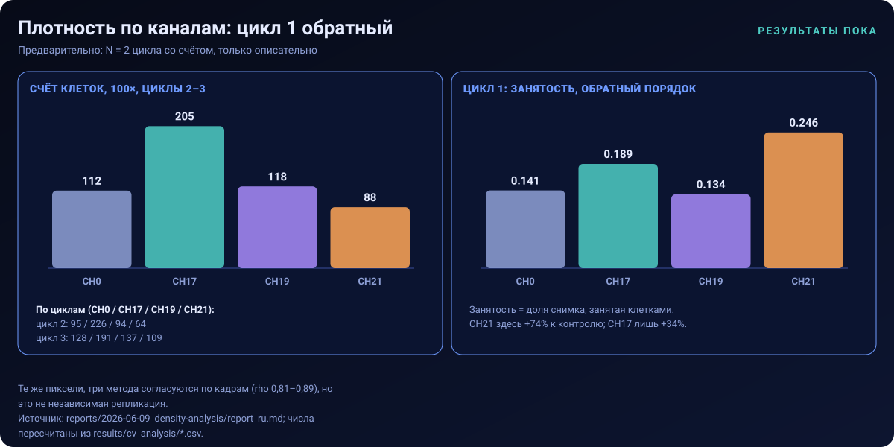

**[English](RESULTS.md) | Русский**

[← Исследование влияния гиперболических полей на Saccharomyces cerevisiae](../README.ru.md) · [Указатель страниц](README.ru.md)

# Результаты пока

## Ключевые результаты

**Что проанализировано.** Первый пакет снимков: <!--n:llm_fields-->920<!--/n--> полей оценены слепым LLM, <!--n:count_fields-->398<!--/n--> полей посчитаны cyto2 и <!--n:occupancy_fields-->972<!--/n--> полей оценены по занятости, циклы 001–003 (<!--n:images_total-->990<!--/n--> изображений всего). Плотность клеток дрожжей различается по каналам в двух циклах, где есть счёт: **CH17 самый плотный, CH21 ниже контроля, CH19 совпадает с контролем по счёту.** Собственный вывод исследования: *направленный сигнал в циклах 2–3, пока не воспроизводимый эффект*: цикл 1 обращает порядок, счёт клеток опирается на два цикла, p-значения описательные.

### Сравнительные результаты

| Параметр | Контроль (CH0) | CH17 | CH19 | CH21 |
|---|:---:|:---:|:---:|:---:|
| **Счёт клеток 100×** | <!--n:mean_ch0-->112<!--/n--> | **<!--n:mean_ch17-->205<!--/n--> (<!--n:pct_ch17-->+83<!--/n-->%)** | <!--n:mean_ch19-->118<!--/n--> (<!--n:pct_ch19-->+5<!--/n-->%) | **<!--n:mean_ch21-->88<!--/n--> (<!--n:pct_ch21-->−21<!--/n-->%)** |
| **к контролю (×)** | 1.0× | **≈1.6–1.8×** | ≈1.05× | ≈0.79× |
| **Ранг занятости (циклы 2–3)** | средн. | **1-й** | 2-й | **4-й (самый низкий)** |
| **Площадь клеток 100×** | база | −12.7% (p≈6e-11 = 0.00000000006, вероятность случайности) | −7.6% (p≈6e-5 = 0.00006) | −6.1% (p≈4e-3 = 0.004) |
| **Форма (вытянутость)** | база | незначимо | круглее, не тоньше | незначимо |

Полей со счётом по каналам: <!--n:n_ch0-->82<!--/n--> (контроль), <!--n:n_ch17-->112<!--/n--> (CH17), <!--n:n_ch19-->110<!--/n--> (CH19), <!--n:n_ch21-->94<!--/n--> (CH21). Эти числа пересчитаны для этой страницы из `results/cv_analysis/white_counts.csv` и `data/photos/journal-mapping.csv`; они воспроизводят отчёт. Это проверяет арифметику и сопоставление, но не сами снимки.

### Ключевые выводы

| Канал | Эффект | Интерпретация |
|---|---|---|
| **CH17** | +83% к счёту, ≈1.6–1.8× контроля, самый плотный во всех методах (циклы 2–3, 100×) | Сильнейший стимулятор роста в этих двух циклах |
| **CH21** | −21% к счёту, ниже контроля, самый разреженный во всех методах | Замедление, как и предсказано, но цикл 1 это обращает |
| **CH19** | ≈ контроль по счёту (ОЖИДАЕМО, не нулевой); клетки ~7.6% меньше по площади (p≈6e-5), но это у всех каналов поля, и НЕ более вытянутые (скорее круглее); почкование без изменений | Гипотеза «тоньше / быстрее делятся» на этой конечной точке НЕ подтверждена; нужны тайм-лапс и поклеточная морфометрия |

> **Оговорка:** предварительно. Два цикла из трёх согласуются; цикл 1 обращает порядок; данные псевдореплицированы, p-значения описательные; само исследование просит ≥5 циклов.

## По циклам и по методам

| Цикл | CH0 | CH17 | CH19 | CH21 |
|---|:---:|:---:|:---:|:---:|
| Цикл 2 (счёт 100×) | <!--n:cyc2_ch0-->95<!--/n--> | **<!--n:cyc2_ch17-->226<!--/n-->** | <!--n:cyc2_ch19-->94<!--/n--> | **<!--n:cyc2_ch21-->64<!--/n-->** |
| Цикл 3 (счёт 100×) | <!--n:cyc3_ch0-->128<!--/n--> | **<!--n:cyc3_ch17-->191<!--/n-->** | <!--n:cyc3_ch19-->137<!--/n--> | **<!--n:cyc3_ch21-->109<!--/n-->** |
| Цикл 1 (только занятость) | <!--n:occ1_ch0-->0.141<!--/n--> | <!--n:occ1_ch17-->0.189<!--/n--> | <!--n:occ1_ch19-->0.134<!--/n--> | **<!--n:occ1_ch21-->0.246<!--/n-->** |

CH17 первый, а CH21 последний в обоих циклах со счётом. В цикле 1 нет разделения по увеличению и нет счёта; по занятости самый плотный CH21 (<!--n:occ1_pct_ch21-->+74<!--/n-->% к контролю), CH17 второй (<!--n:occ1_pct_ch17-->+34<!--/n-->%), что обращает оба главных утверждения. Это смена знака в данных, а не выброс.

## Предварительные результаты

**Статус:** проанализирован первый пакет снимков (990 изображений всего, циклы 001–003).

**Ключевой вывод:** направленный эффект на плотность клеток по трём независимым методам анализа изображений (CV-счёт, CV-занятость, слепой LLM): **CH17 выше всех (~×1.6–1.8 к контролю), CH21 ниже контроля, CH19 ≈ контроль.** Направленно согласуется с предсказанием протокола (CH21 замедляет деление). Прежний README называл это «воспроизводимым»; отчёт говорит «пока не воспроизводимый эффект», и пользоваться надо этой формулировкой.

| Канал | Счёт 100× | к контролю |
|---|:---:|:---:|
| CH0 (контроль) | <!--n:mean_ch0-->112<!--/n--> | — |
| **CH17** | **<!--n:mean_ch17-->205<!--/n-->** | **+83 %** |
| CH19 | <!--n:mean_ch19-->118<!--/n--> | +5 % |
| **CH21** | **<!--n:mean_ch21-->88<!--/n-->** | **−21 %** |

Согласие методов по кадрам (Спирмен): счёт ↔ занятость ρ=0.88; занятость ↔ LLM ρ=0.89; счёт ↔ LLM ρ=0.81 (при 100×).

> **Предварительно, не доказательство:** только 3 цикла, цикл 1 противоречит, нет масштабной линейки; доказательство — согласованность методов и циклов, а не p-значения. Нужно ≥5 циклов.

## Границы пакета

1. **Репликация.** Три цикла; сигнал держится в циклах 2–3, а цикл 1 ему противоречит (другой протокол съёмки, нет разделения по увеличению).
2. **Псевдорепликация.** Поля внутри цикла не независимы, поэтому p-значения по кадрам только описательные.
3. **Нет масштабной линейки.** Плотности относительные (клеток на поле, доля занятости), а не клеток на мл.
4. **Систематический недосчёт.** cyto2 пропускает около 40% клеток в плотных полях; относительное сравнение каналов остаётся верным, абсолютные счёты — нет.
5. **Возможные артефакты съёмки** (фокус, разведение, сессия) по каналам не исключены; два CV-метода читают одни пиксели.
6. **Нет меры жизнеспособности.** Витального красителя в этом пакете нет.
7. **Кинетическая гипотеза CH19 не проверяема по статичным конечным точкам.** Нужны время удвоения по OD600 и тайм-лапс.

Полный отчёт: [EN](../reports/2026-06-09_density-analysis/report_en.md) | [RU](../reports/2026-06-09_density-analysis/report_ru.md).

## Отчёты

| № | Отчёт | Дата | Статус | EN | RU |
|:---:|---|:---:|:---:|:---:|:---:|
| 1 | Отклик плотности на воздействие поля (CV + LLM) | 2026-06-09 | Завершено | [EN](../reports/2026-06-09_density-analysis/report_en.md) | [RU](../reports/2026-06-09_density-analysis/report_ru.md) |

Протокол эксперимента — [`reports/experiment_protocol_ru.md`](../reports/experiment_protocol_ru.md) ([EN](../reports/experiment_protocol_en.md)).
