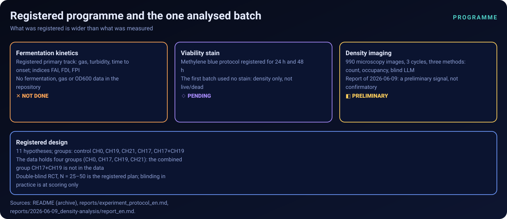
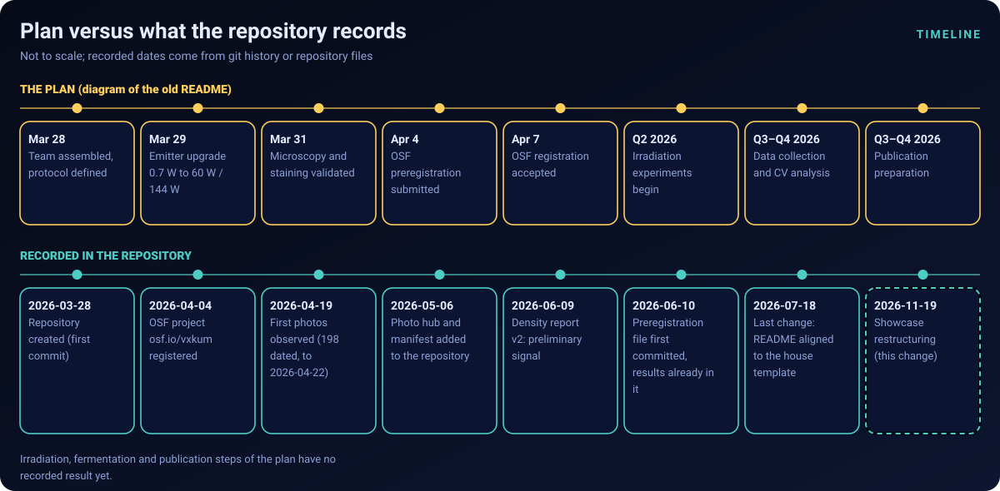

**English | [Русский](STUDY.ru.md)**

[← Hyperbolic Field Saccharomyces Cerevisiae Study](../README.md) · [Guide index](README.md)

# The study

## What this study is

This research project investigates the effects of hyperbolic field modulation on biological process dynamics using *Saccharomyces cerevisiae* as a model system. The study is part of a broader research program focused on chrono-regulatory and biochronal mechanisms in living systems.

The central objective is to determine whether controlled exposure to a structured physical field can induce measurable changes in fermentation kinetics, metabolic activity, and temporal organization of biochemical processes. Yeast fermentation provides a well-characterized and quantifiable system for assessing rate-based biological responses under controlled experimental conditions.

The study employs a controlled experimental design comparing exposed and non-exposed samples, with continuous and time-resolved measurements of fermentation dynamics. Primary outcome measures include fermentation rate, gas production, and temporal progression of metabolic activity.

This work aims to establish a reproducible experimental framework for investigating field-mediated modulation of biological systems, with potential implications for broader applications in biophysics, systems biology, and non-pharmacological regulation of biological processes.

All experimental materials, protocols, and data will be made available via the associated OSF project and integrated GitHub repository to ensure transparency and reproducibility.

**Where it stands.** Yeast cells were imaged under four conditions (a control and three emitter channels) in <!--n:cycles-->3<!--/n--> repeated experiments. In the two repeats that have cell counts, channel 17 shows more cells per field than control (<!--n:pct_ch17-->+83<!--/n-->%) and channel 21 fewer (<!--n:pct_ch21-->−21<!--/n-->%), and a blind AI scorer agrees on the ordering; the third repeat points the other way. The study calls this a preliminary directional signal, not a confirmed effect. Fermentation kinetics, viability and the channel 19 division-rate hypothesis have not been tested. A patent application is an IP claim, not validation of the field effect.

## Registered versus analysed

The registered programme is fermentation kinetics: gas production, turbidity and time to onset, summarised in three indices (see [Hypotheses and design](DESIGN.md#outcome-variables)). The only data analysed so far is a single batch of static microscopy photographs (<!--n:images_total-->990<!--/n--> files, <!--n:cycles-->3<!--/n--> cycles) that yields **cell density**, not fermentation and not viability. The repository says so itself: the first batch used no viability stain, and staining, OD600 and fermentation outcomes remain pending. The headline comparison and its limits are on [Results so far](RESULTS.md); the claim-by-claim ledger is on [Evidence](EVIDENCE.md).

## Timeline

The upper lane is the plan as the earlier README drew it (`charts/mermaid/root_3.png`, still in the repository). The lower lane is what git history and the files record; each date was checked against its source when the picture was built. The plan places irradiation experiments in the second quarter of 2026 and data collection in the second half; the repository holds photographs dated <!--n:date_first-->2026-04-19<!--/n--> to <!--n:date_last-->2026-04-22<!--/n--> (<!--n:images_dated-->198<!--/n--> of <!--n:images_total-->990<!--/n--> carry a date) and no later experimental record.

## Research team

| Name | Role | Responsibilities |
|---|---|---|
| **Valeria Ovseannicova** | Director of Biomedical Research Department; Chief Researcher & Head of Experimental Work | Author of the experimental program and methodology; research infrastructure and hardware development; full-cycle research; hyperbolic field physics |
| **Denis Banchenko** | Program Director, Author of Methodology & Technology | Coordination, OSF registration, workflow |
| **Alexandr Ovsyannikov** | Head Hardware Engineer | Electrical systems |
| **Mykhailo Kapustin** | CTO & Director of AI and IT | Data infrastructure |
| **Kyryl Zmiienko** | Chief AI Engineer | Hypothesis formulation, scientific analysis |
| **Ivan Savelyev** | Science Director & Editor-in-Chief ASRP.science | Data logging protocols, methodology review |
| Two laboratory assistants (senior and junior) | Laboratory staff | Sample preparation, probe separation, laboratory support |

The earlier README lists eight researchers; the two laboratory assistants are not named here (private persons, memory policy). No participant data exists in this study: the subject is yeast.

## Keywords

**Subjects:** Biomedical Engineering, Medical Microbiology, Biophysics, Systems Biology, Food Microbiology, Environmental Microbiology, Microbiology, Life Sciences, Medical Sciences, Biochemistry

**Tags:** biochronal processes, biological systems, biophysical fields, chrono-regulation, experimental biophysics, fermentation kinetics, field effects on biology, hyperbolic field, hyperbolic field modulation, non-classical interactions, saccharomyces cerevisiae, yeast fermentation

## Status

**Last updated** (earlier README): June 2026. **Status:** Preliminary results; the irradiation and fermentation track is stated as ongoing.

### Roadmap

The density batch is the first analysed slice of a larger preregistered programme. The full protocol (<!--n:hypotheses-->11<!--/n--> OSF-registered hypotheses, RCT N=25–50, double-blind) covers the irradiation/fermentation track that is still ongoing. Pending: additional cycles (≥5), staining/viability, OD600 calibration, and the full CV pipeline scripts.
