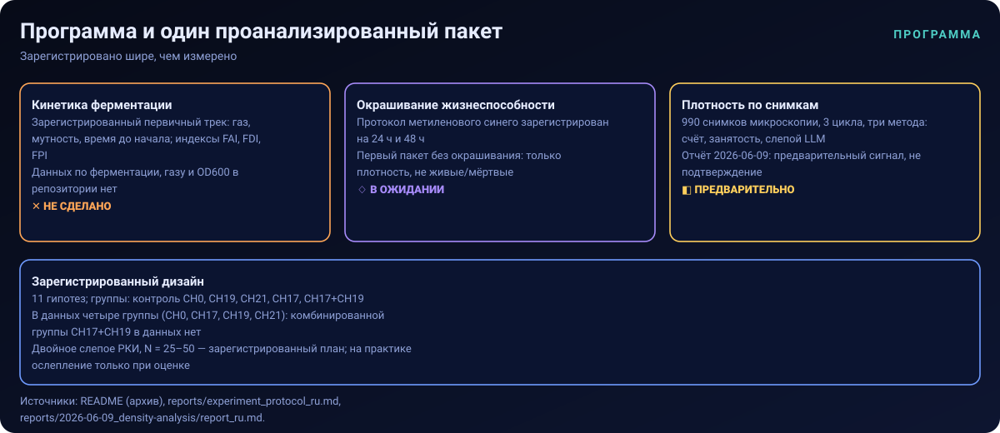
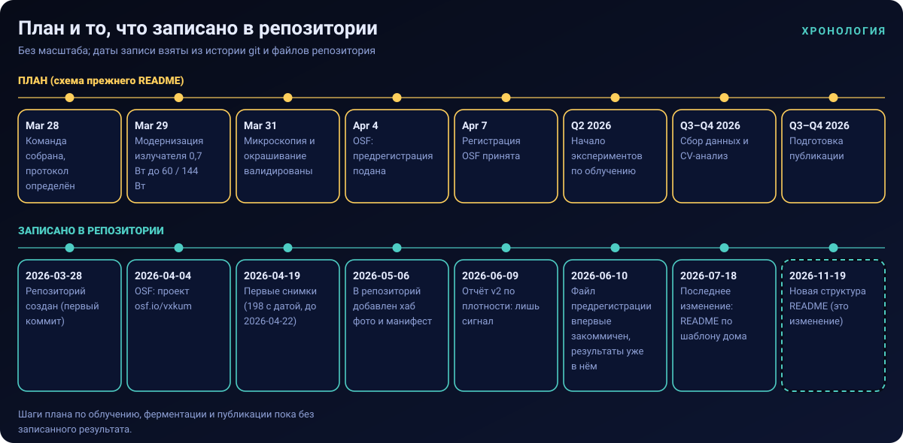

**[English](STUDY.md) | Русский**

[← Исследование влияния гиперболических полей на Saccharomyces cerevisiae](../README.ru.md) · [Указатель страниц](README.ru.md)

# Исследование

## Что это за исследование

Данный исследовательский проект изучает влияние модуляции гиперболическим полем на динамику биологических процессов с использованием *Saccharomyces cerevisiae* в качестве модельной системы. Исследование является частью более широкой программы, сфокусированной на хроно-регуляторных и биохронных механизмах в живых системах.

Центральная задача — определить, может ли контролируемое воздействие структурированного физического поля вызвать измеримые изменения в кинетике ферментации, метаболической активности и временной организации биохимических процессов. Дрожжевая ферментация обеспечивает хорошо охарактеризованную и количественно измеримую систему для оценки биологических ответов на основе скорости в контролируемых экспериментальных условиях.

Исследование использует контролируемый экспериментальный дизайн, сравнивающий облучённые и необлучённые образцы, с непрерывными и временно-разрешёнными измерениями динамики ферментации. Первичные исходные показатели включают скорость ферментации, газообразование и временную прогрессию метаболической активности.

Данная работа направлена на создание воспроизводимой экспериментальной основы для изучения полевой модуляции биологических систем, с потенциальными применениями в биофизике, системной биологии и нефармакологической регуляции биологических процессов.

Все экспериментальные материалы, протоколы и данные будут доступны через проект OSF и интегрированный репозиторий GitHub для обеспечения прозрачности и воспроизводимости.

**Где всё сейчас.** Клетки дрожжей снимали в четырёх условиях (контроль и три канала излучателя) в <!--n:cycles-->3<!--/n--> повторных экспериментах. В двух повторах, где есть счёт клеток, канал 17 даёт больше клеток на поле, чем контроль (<!--n:pct_ch17-->+83<!--/n-->%), а канал 21 меньше (<!--n:pct_ch21-->−21<!--/n-->%); слепой ИИ-оценщик согласен с порядком; третий повтор показывает обратное. Исследование называет это предварительным направленным сигналом, а не подтверждённым эффектом. Кинетика ферментации, жизнеспособность и гипотеза скорости деления для канала 19 не проверялись. Патентная заявка — это заявка на защиту, а не подтверждение эффекта поля.

## Зарегистрировано и проанализировано

Зарегистрированная программа — кинетика ферментации: газообразование, мутность и время до начала, сведённые в три индекса (см. [Гипотезы и дизайн](DESIGN.ru.md#переменные-исхода)). Единственные проанализированные пока данные — один пакет статичных снимков микроскопии (<!--n:images_total-->990<!--/n--> файлов, <!--n:cycles-->3<!--/n--> цикла), из которого получается **плотность клеток**, а не ферментация и не жизнеспособность. Репозиторий говорит об этом сам: первый пакет снят без красителя жизнеспособности, а окрашивание, OD600 и ферментация остаются в работе. Главное сравнение и его границы — на странице [Результаты пока](RESULTS.ru.md); реестр утверждений — на странице [Доказательства](EVIDENCE.ru.md).

## Хронология

Верхняя дорожка — план в том виде, как его рисовал прежний README (`charts/mermaid/root_3.png`, файл остаётся в репозитории). Нижняя — то, что записано в истории git и файлах; каждая дата сверена с источником при сборке картинки. План ставит эксперименты по облучению на второй квартал 2026 и сбор данных на второе полугодие; в репозитории лежат снимки с <!--n:date_first-->2026-04-19<!--/n--> по <!--n:date_last-->2026-04-22<!--/n--> (дата есть у <!--n:images_dated-->198<!--/n--> из <!--n:images_total-->990<!--/n-->) и никакой более поздней экспериментальной записи.

## Команда

| ФИО | Роль | Обязанности |
|---|---|---|
| **Валерия Овсянникова** | Директор департамента биомедицинских исследований; главный исследователь и руководитель экспериментальных работ | Автор экспериментальной программы и методологии; разработчик исследовательской инфраструктуры и аппаратных установок; проведение исследований полного цикла; физика гиперболических полей |
| **Денис Банченко** | Директор программы, автор методологии и технологии | Координация, OSF, рабочий процесс |
| **Александр Овсянников** | Главный инженер по аппаратному обеспечению | Электрические системы |
| **Михайло Капустин** | Технический директор, директор ИИ и ИТ | Инфраструктура данных |
| **Кирилл Змиенко** | Главный ИИ-инженер | Формулировка гипотез, научный анализ |
| **Иван Савельев** | Директор по науке, главный редактор ASRP.science | Протоколы логирования, обзор методологии |
| Два лаборанта (старший и младший) | Лабораторный персонал | Подготовка образцов, разделение проб, лабораторная поддержка |

В прежнем README перечислены восемь исследователей; двух лаборантов здесь не называем (частные лица, политика памяти). Данных участников в исследовании нет: объект исследования — дрожжи.

## Ключевые слова

**Области:** биомедицинская инженерия, медицинская микробиология, биофизика, системная биология, пищевая микробиология, экологическая микробиология, микробиология, науки о жизни, медицинские науки, биохимия

**Теги:** биохронные процессы, биологические системы, биофизические поля, хроно-регуляция, экспериментальная биофизика, кинетика ферментации, полевые эффекты на биологию, гиперболическое поле, модуляция гиперболическим полем, неклассические взаимодействия, saccharomyces cerevisiae, ферментация дрожжей

## Статус

**Последнее обновление** (прежний README): июнь 2026. **Статус:** предварительные результаты; трек облучения и ферментации заявлен как продолжающийся.

### Дорожная карта

Пакет плотности — первый проанализированный срез более широкой предзарегистрированной программы. Полный протокол (<!--n:hypotheses-->11<!--/n--> гипотез на OSF, РКИ N=25–50, двойное слепое) охватывает трек облучения/ферментации, который ещё продолжается. В работе: дополнительные циклы (≥5), окрашивание/жизнеспособность, калибровка OD600 и полные скрипты CV-пайплайна.
